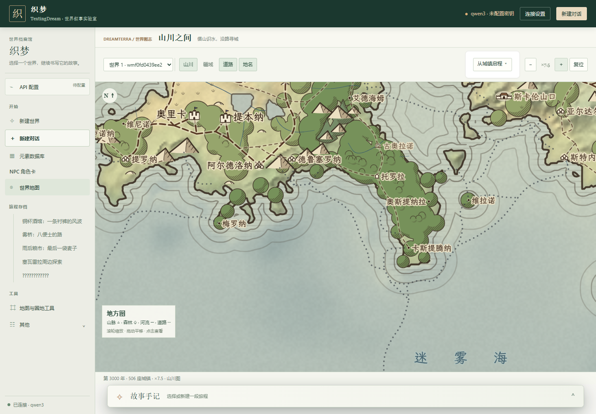
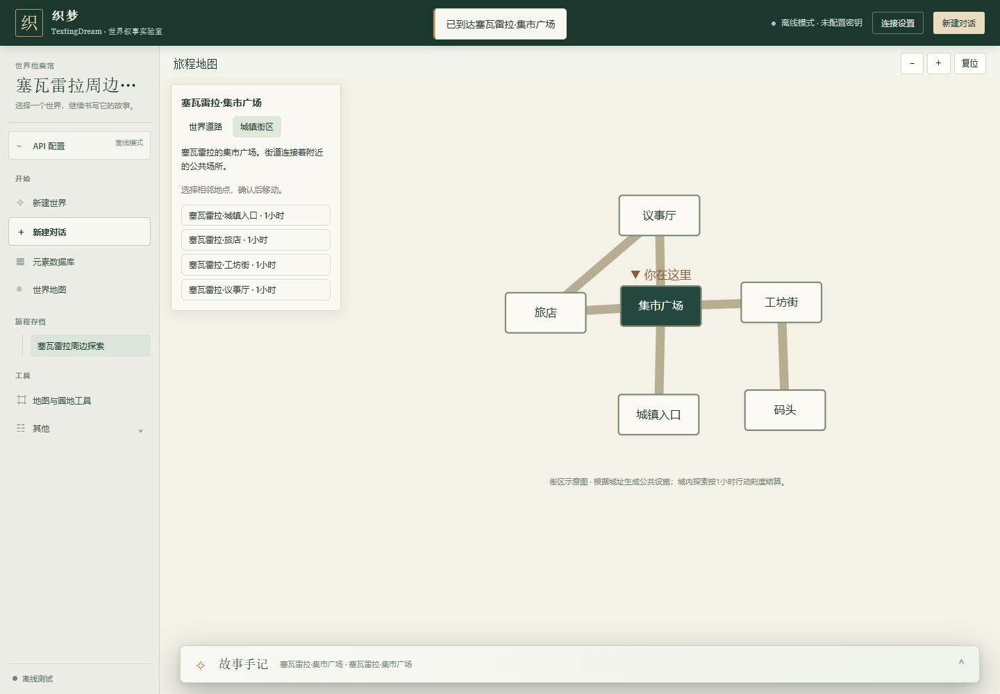
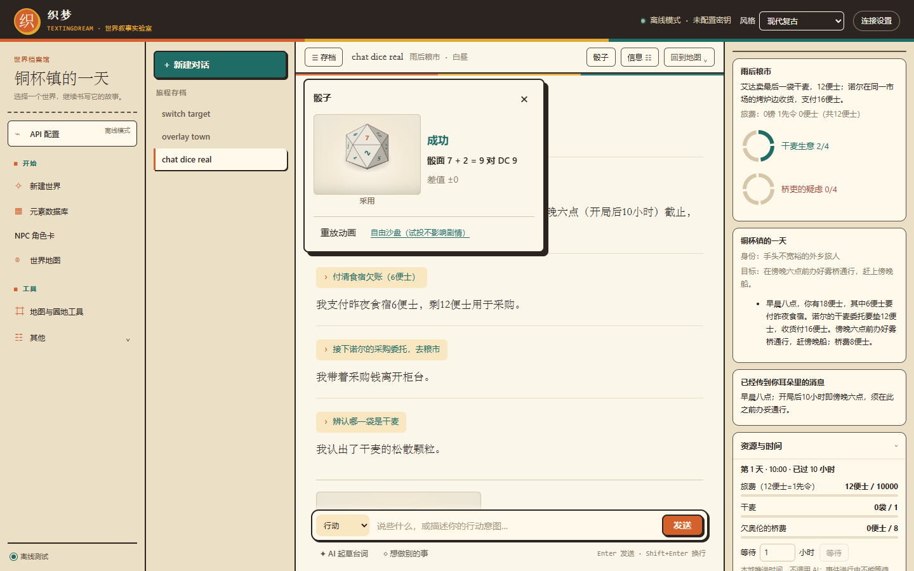
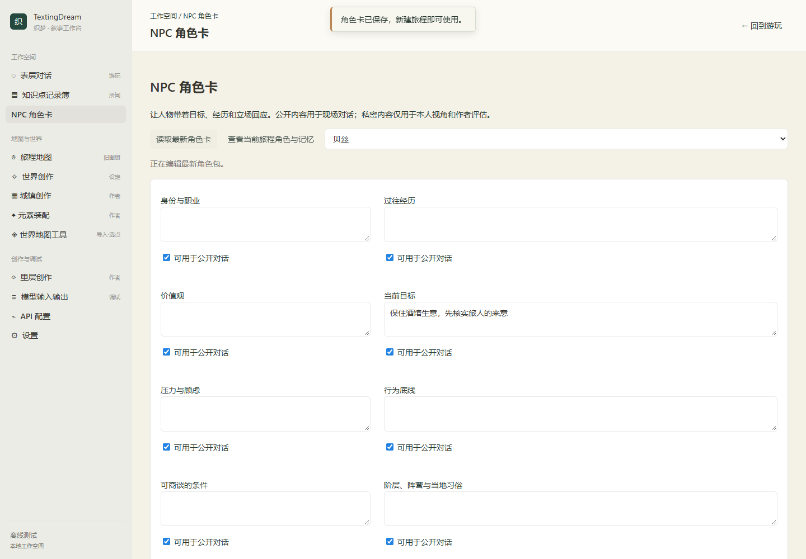
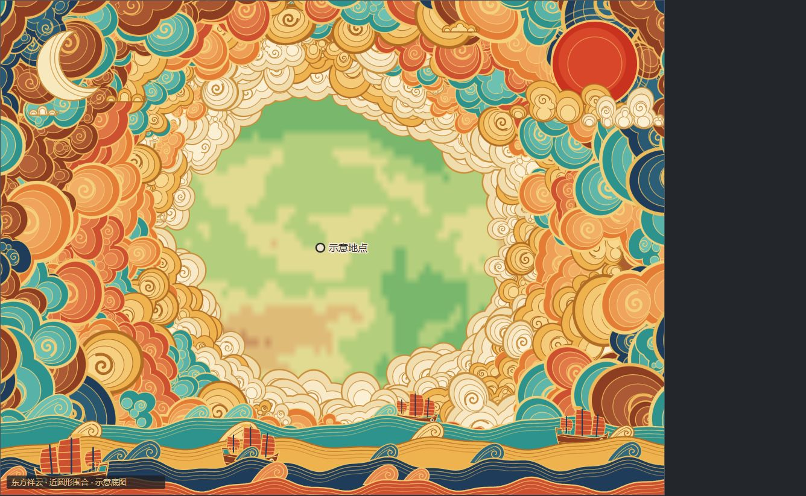
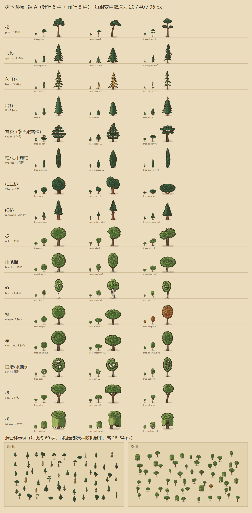
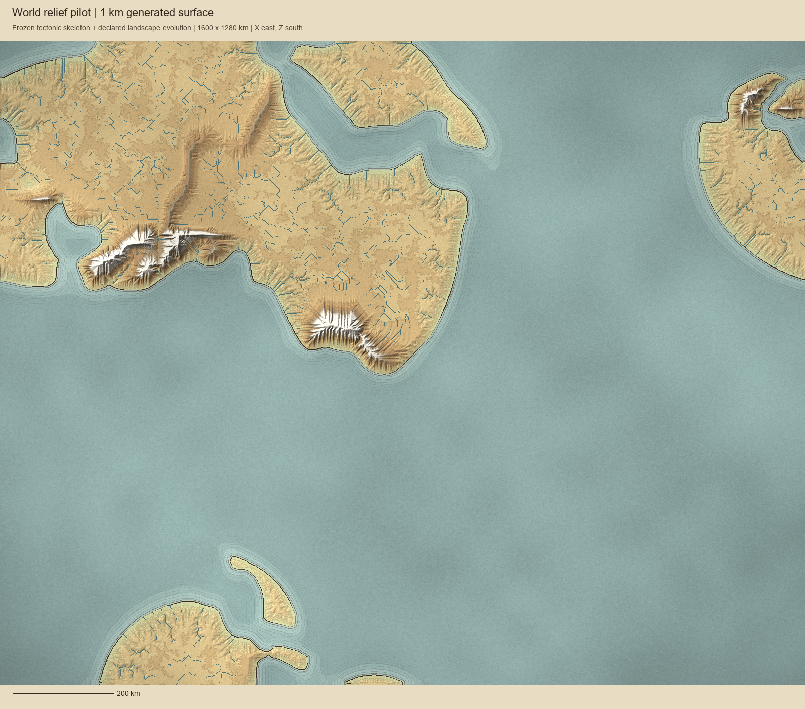

# 织梦：一个让世界记住你做过什么的文字冒险

> **产品介绍，不是完成度清单（2026-11-08 整理）**：下面描述目标体验和已有的 civ-atlas 旅行。新世界层、城镇布局和天气画面的接入范围见 [../现状.md](../现状.md)。

跑过团的人都知道，跑团好玩的地方往往是计划外的部分：玩家不按剧本走，主持人临场想办法接住，桌上每个人都记得那天谁把事情搞砸了。

**织梦（TextingDream）** 想在电脑上做出这种体验。它是一个中文跑团式叙事工作台：有地图、有人物、有骰子，由大语言模型负责理解你的意图和讲述故事，由一套规则引擎负责记账和裁决。

它现在是开发中的项目，还不是成品。下面介绍它已经能做到什么，以及还差什么。

---

## 一张真的可以走的地图

*作者模式下的世界地图。城镇、道路、山林和河流都来自同一份地图数据，“迷雾海”以外是尚未探明的区域。*

织梦的地图基于开源项目 [civ-atlas](https://github.com/guaner-334/civ-atlas) 生成。这张图不是装饰：游戏里的旅行按地图上真实的道路计算，走一段路要花多少时间，时间就会真的流逝。城镇的位置、哪些城镇在开局那一年还存在，也都从地图数据里读。

开发过程中也踩过坑。有一次检查发现，558 个城址里有 113 个被画进了海里：地块数据记的是陆地，但绘制时岸线平滑把它们淹掉了。修正后，同一份地图里落在水面上的城址是 0。

## 走进城里

*进入城镇后切换到街区示意图。集市广场、旅店、议事厅、工坊街、码头之间各隔一小时。*

到了一座城，地图换成街区示意图。你可以去旅店打听消息，去码头找船，去议事厅办事。目前城内移动以一小时为单位结算，还不是连续行走。

## 骰子会说话，但不会撒谎

*“雨后粮市”短篇里，辨认干麦的检定：骰面 7 + 加值 2 = 9，对难度 9，成功。右侧是时间、钱和任务进度。*

跑团离不开骰子。织梦有一套带物理效果的 3D 骰子（d6、d8、d12、d20），可以用鼠标拿起来扔。不过在正式游戏里，结果由服务器的规则引擎算出，骰子动画只负责把这个结果演出来，不会因为画面上滚到别的面就改判。

这是织梦的一条基本原则：**模型负责讲故事，引擎负责记账。** 钱、物品、检定结果、谁欠谁的，都由引擎写入存档。模型不能在叙述里凭空给你一袋金币，也不能自己宣判你被抓进牢里。

钱币采用旧英制：12 便士是 1 先令，20 先令是 1 镑。在粮市短篇里，你一开始只有 18 便士，要付清 6 便士的食宿欠账，再在傍晚六点前凑够 8 便士的过桥费。

## 有自己想法的人物

*作者编辑 NPC 角色卡。每一栏都可以选择是否用于公开对话。*

每个 NPC 都有一张角色卡：身份、过往经历、价值观、当前目标、压力、行为底线、可以谈的条件。比如酒馆老板贝丝的目标是“保住酒馆生意，先核实旅人的来意”。

人物知道的事情也分来源：亲眼看到的、听来的传闻、自己的推测、误会。NPC 会记住在同一地点亲眼目睹的你的行为，并随存档保存。目前消息还不会自动传遍全城。

## 三个小故事

现在织梦里有三个可以玩的短篇：

- **铜杯酒馆：一条衬裤的风波**
- **雾桥：八便士的路**
- **雨后粮市：最后一袋麦子**

每个短篇都有目标、需要确认的风险操作、属性检定、分支和几种结局。失败也能继续往下走，只是换一条路。我们的设计目标是每篇 15–20 分钟，但还没有找真实玩家计时。

## 正在画的东西

*东方风格的地图迷雾素材：祥云围出已探索区域，下方是海水纹和福船。*

未探索的地方会被迷雾遮住。美术素材已经做了两套风格，西方中世纪的卷云和海浪、帆船，东方玄幻的祥云、海水纹和福船，玩家可以在设置里自己选。这些素材目前还没有接进游戏地图。

*树木图标样张：松、云杉、橡、桦、柳等 16 种树，每种 3 个形态，下方是混合林的排布示例。*

地图上的森林也在换装，计划按气候和地区摆上对应的树种。图上是第一组样张，还在调整。

*地貌试验：从板块构造骨架出发，加上河流侵蚀，生成 1 公里精度的地表。*

更远一点，团队在试验更细的地形生成，让山脉、河谷和海岸线更像真实地貌。这部分还是实验，没有进入游戏。

---

## 还差什么

说实话，织梦离“可以拿给朋友玩”还有一段距离：

- 地图旅行、人物对话、检定、钱币和结局各自能跑，但还没有串成一条完整走通的流程。
- 接上真实大模型后，对白质量、人物记忆是否前后一致、每小时花多少 token，都还没有系统测过。
- 还没做过玩家盲测。

下一步的目标很具体：做一个小镇、三个地点、三到五个人物、一件 15–20 分钟能处理完的事，至少两个结局，允许玩家正经解决、失败后绕路，或者胡闹一通并承担后果。

织梦想做的不是一个什么都能生成的世界，而是一个会认真对待你每个决定的小世界。

---

项目地址：<https://github.com/HouraisanSeiran/-TextingDream>（开发快照，接口与数据格式仍会变动）
