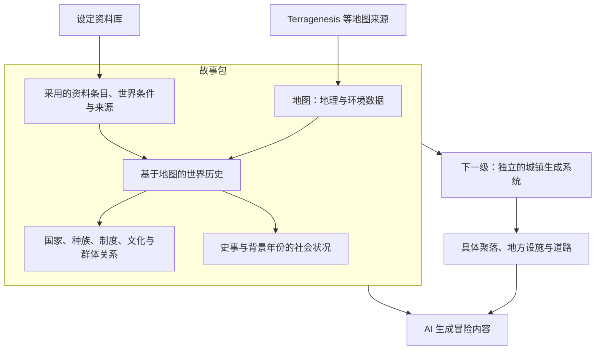

# 故事包定义与层级

更新：2026-11-13。状态：依据项目负责人本轮说明确定目标定义；现有实现差异见第 7 节。本文明确内容职责与上下级关系；本轮背景文件与作者操作见 [世界背景生成与发布](world-background-pipeline.md)。

## 1. 故事包是什么

**故事包包括地图和基于这份地图的世界历史，为 AI 产生和延续故事提供一致的世界背景。世界历史包括国家、种族等社会内容的形成、演变、相互关系，以及背景年份时的社会状况。**

地图包括 Terragenesis 等来源的地形、海陆、水系、气候和温度等地理与环境数据。世界历史以地图上的空间、环境和位置关系为依据，说明国家在哪里形成、如何兴衰，不同种族和社会群体如何生活、交往并形成当下的制度与文化。地理提供条件，不单独决定社会制度或人物态度。

设定资料库中的种族、魔法、文化、制度等资料条目，是本世界采用的通用定义与参考。条目说明可采用什么设定；世界历史说明这些设定在这份地图和这个时代中如何具体存在、变化并相互影响。采用清单、固定版本、来源和魔法等世界条件也保存在故事包中。

“完整”指本世界采用的设定、数据与背景能共同确定世界，不限定为单一文件，也不要求一次把全部内容送进模型。本轮结构化背景存放于 `StoryPackage/背景_bgv_*/background.json`，配合总概及知识文档；大型地理数组继续关联已登记来源。

故事包的定义覆盖世界背景；事件、任务与对话是基于该背景形成的冒险内容，不能单独代表故事包的全部职责。

## 2. 内容与系统层级

图中的包内关系表示概念归属：国家、种族及其他社会内容属于世界历史，地图为历史提供空间与环境依据。包外箭头表示来源或后续使用。故事包提供世界背景和约束，城镇生成负责下一级具体内容；两者保持独立的生成职责。故事包可以关联已采用的城镇与道路生成结果，使它们成为该世界可用的内容。

## 3. 故事包整合什么

| 内容及归属 | 故事包中的作用 | 来源与界限 |
|---|---|---|
| 地图：世界地理与环境 | 地形、海陆、水系、气候、温度、降水、季节等空间与环境背景 | 关联 Terragenesis 等来源实际提供的数据、来源标识、地图尺度、统计方式和限制 |
| 世界历史：史事与时代状况 | 说明当前时代如何形成，以及背景年份时的社会状况 | 固定已采用的历史来源；模拟史事、作者创作与 AI 草稿注明各自性质 |
| 世界历史：国家与人文区域 | 国家的形成、兴衰、疆域、制度、相互关系，以及大陆命名和人文分组 | 大陆自然形态遵循地图；国家范围不能被说成精确行政边界 |
| 世界历史：种族及社会处境 | 种族在本世界的分布、社会地位、交往与冲突及其历史变化 | 通用特征来自采用资料；在世界中存在不等于每个地点都有居民，不宣称已模拟完整迁徙过程 |
| 世界历史：制度、文化与群体关系 | 国家及组织的制度、文化差异、群体地位，以及对不同个体与种族的行为差异 | 为人物社会互动提供条件；具体态度、衣装与行为造成的第一印象仍由下级人物和对话内容落实 |
| 采用资料与世界条件 | 确定种族特征、魔法等力量体系、适用条件与代价 | 固定资料条目及版本；魔法对社会的影响归入世界历史，可执行玩法规则另按实现接入 |
| 背景知识与叙述资料 | 将上述数据与设定整理为 AI 可以使用的背景 | 保留资料依据、适用范围及公开或隐藏信息的区分 |
| 下级内容关联 | 标明本世界已经采用哪些城镇与道路产物 | 关联具体产物及其版本、归属，不将城镇生成逻辑并入背景生成 |

故事包采用本世界需要的资料条目，并保留采用范围与版本。设定资料库继续独立积累资料；新增条目不自动成为所有既有世界的事实。以上是内容概念的归属，不要求将国家、种族和史事存进同一张表或同一个 JSON 字段。

气候与温度等数据按实际来源使用：月平均、年统计、短期天气各有不同含义；缺少的字段列明缺项。世界背景的文字描述与数据口径需要一致。

## 4. 故事包与城镇生成怎样分工

| 事项 | 故事包负责 | 城镇生成系统负责 |
|---|---|---|
| 世界身份与时代 | 确定所在世界、背景时期与采用的设定 | 在指定世界和时期内生成具体内容 |
| 自然环境 | 关联地理产品、环境数据和可用图层 | 读取所在区域的条件，用于选址、布局及道路规划 |
| 大陆与国家 | 依据地图确定人文区域，并在世界历史中确定国家、制度及其演变 | 补充指定国家内的具体聚落与地方内容 |
| 聚落 | 提供历史或宏观背景中已确定的聚落约束 | 补充城镇、村落、设施及其布局和归属 |
| 道路 | 提供宏观往来关系、交通需求及制度限制 | 补充具体连接、走向与地方道路内容 |
| 社会背景 | 在世界历史中说明制度、文化、种族处境、群体关系和魔法的社会影响 | 将这些条件落实到当地居民、组织和服务条件 |
| 内容采用 | 组织本世界采用的背景及下级产物 | 独立生成草稿或版本，供采用后关联到本世界 |

城镇生成的目标范围包含王国内的聚落与道路补充，以及具体城镇的细化。2026-11-13已连接王国聚落选址、规划道路与单镇四阶段、布局和版本发布；道路是否建成及实际施工由后续内容确定。

历史中已确定的首都、古城、毁城和既有道路，可作为下级生成的约束或待细化对象。城镇生成保持这些对象的身份和背景一致；改变已确定的王国、史事或自然环境，需要在相应上级内容中确认变更。

地方选址和道路细化同时考虑地理数据的分辨率。世界级栅格只提供对应尺度的条件，局部街道与建筑细节需要城镇层自身的细化依据。

## 5. AI 怎样使用故事包

故事包提供一致的世界内容范围，实际输入可以按生成任务组织：宏观背景生成读取相关地理、设定和历史；城镇生成读取指定王国及区域条件；冒险生成再结合当地聚落、道路与人物内容。

建议保留一份简明的世界总概，再按任务检索或查询必要细节。大型地理数组通过取样、区域摘要或可查询的数据提供相关信息；故事包对这些来源保持完整关联，模型上下文按实际任务取用。

世界客观背景、作者隐藏资料与角色已经知道的信息分别组织。人物的辅助注意和猜测提示依照其能力与知情范围产生，不能因为作者侧故事包包含某项秘密就直接向角色透露。

## 6. 生成与版本关系

建议采用以下依赖顺序：

1. 选定地图与环境来源，以及本世界采用的资料条目和世界条件。
2. 基于地图整理、生成并确认世界历史，包括史事、国家、种族、制度、文化和群体关系，形成故事包背景版本。
3. 城镇生成系统基于明确的背景版本和王国范围，补充聚落与道路。
4. 审阅下级产物，关联为该世界可用的内容，再用于后续冒险与游玩。

该顺序不要求一次生成整个世界的全部城镇。当前按指定国家生成聚落规划，逐镇细化后保存独立王国版本；后续扩大覆盖范围或接入游玩时继续固定版本关系。

沿用版本固定的原则：记录背景和下级产物各自采用的来源，更新时明确变更范围；已有旅程继续使用其绑定的内容。下级产物被采用到新的包版本，与其生成时所依据的背景版本分别记录，避免把新版本中的关联误当成生成前提。

## 7. 当前实现与剩余边界

| 位置 | 当前职责 | 剩余边界 |
|---|---|---|
| [背景作者流程](world-background-pipeline.md) | `WorldPackagePipeline.backgrounds` 固定来源、采用快照、历史及审核，独立发布版本 | 暂不直接开始旅程 |
| [背景地理](../app/background_geography.py) | 六组原生网格摘要、真实连通陆块、背景年王国 LAND 范围 | 文明州尺度代理，不能视为精确行政边界 |
| [背景存储](../app/background_package.py) | `background.json`、总概和知识文档；修订为新版本 | 模型文字仍需作者审核，结构检查不证明全部文字事实一致 |
| [旧世界生成器](../app/world_generator.py)与[旧地区生成流程](world-package-pipeline.md) | 保留城市、路线、角色及事件编译，旧草稿缺目标字段继续走旧流程 | 不作为新宏观背景生成入口 |
| [王国聚落与道路规划](../app/kingdom_settlements.py) | 按背景年本国陆地选址、寻路；冻结来源，逐镇细化并发布独立王国版本 | 道路只作规划，岛间不架桥；不新增历史事实或开始旅程 |
| [城镇存储](../app/towns_store.py) | 复用四阶段、编辑、布局及单镇版本；新输入核对固定背景来源 | 背景城镇暂不直接采用到旧可玩包；布局和经营未进正式旅程 |

当前历史模拟提供国家、年份、兴衰、疆域及史事等基础记录；种族社会处境、制度和文化等由采用资料与 AI 背景草稿补充，并经作者审核。这不表示已经实现完整的种族分布、迁徙、社会关系或制度演变模拟。本轮概念与用词更新保留现有国家及历史字段的读取方式。

旧短篇包与已有存档继续按原格式和绑定版本运行。发布背景不切换当前可玩包；未确认的重大新增史事保留为候选，不进入正式背景事实及下级输入。

## 8. 后续实现的核对点

- 能确定一个故事包使用哪份地理与环境数据、哪些数据库设定及哪一背景时期。
- 历史、大陆和王国背景能够独立于具体城镇布局成立，并供 AI 使用。
- 城镇生成能读取指定包与王国的约束，独立交付聚落和道路产物。
- 历史已确定的地点与下级生成保持同一身份，产物有明确归属与来源。
- AI 使用的背景与实际数据一致，并按生成任务和可见范围取用。
- 新旧生成方式及版本关系明确，旧旅程不被后台换成新背景。

术语见 [CONTEXT.md](../CONTEXT.md)；玩法方向见 [综合游玩建议](综合游玩建议_2026-11-12.md)；资料分派见 [采集交接](element-database/agent-handoff.md)。
