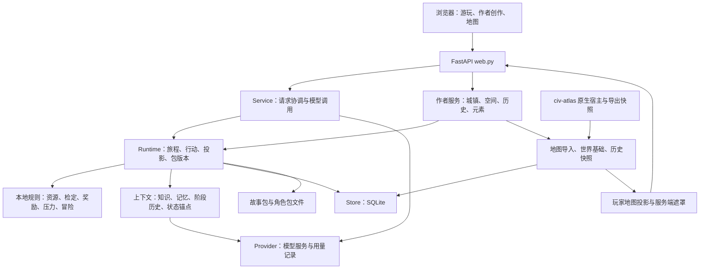
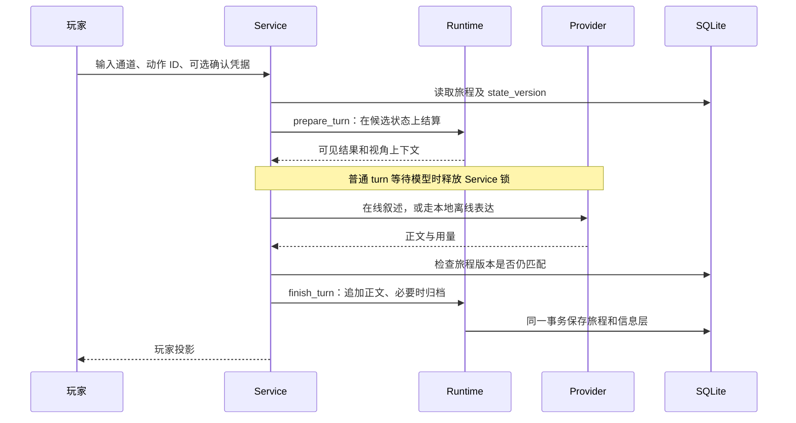

# 织梦 TextingDream：工程框架与评估

评估日期：2026-10-29。对象：当前工作目录，Git HEAD 为 `1398466`，包含大量既有未提交修改与删除；本文描述工作区现状，不代表该提交或远端版本。

## 1. 总体判断

织梦是面向本地单作者的中文 TRPG 叙事工作台。它把世界资料、规则结算、角色知识、作者创作和模型叙述组合在一起，采用 **Python/FastAPI + SQLite + 浏览器 JavaScript** 的单体架构，地图能力接入 civ-atlas。

核心原则是：**规则决定发生了什么，模型负责怎样表达；作者确认的版本决定世界包含什么。** 这条边界已经落实到运行时、版本存储、内容候选和地图投影中，是项目最值得保留的设计。

当前适合继续开发和有指导地验证，尚不足以作为稳定发行版本。主要原因不是功能数量不足，而是三个实际断点：

1. 空世界启动已改变初始化契约，多个旧测试仍依赖自动加载默认故事，核心回归基线失效。
2. 地图后端、作者端和玩家端进度不一致；玩家原生地图仍明确未接入，原生开局也没有城市间道路。
3. README、历史框架说明、当前源码及混入的 Minecraft 资料没有统一状态口径。

建议保留现有单体架构，先完成一条可复现的玩家闭环，再按职责拆分核心模块。当前没有依据要求改成微服务、替换数据库或加入新的代理编排框架。

## 2. 阅读范围与证据等级

本次阅读了入口和路由、Service/Runtime/Store、模型请求、包事务、知识检索、地图投影、原生开局、空间草稿、历史采纳、元素装配等实现，并抽查规则、前端接线、测试和既有文档。

静态盘点：`app/` 顶层有 50 个 Python 文件、25,361 行；`app/static/` 有 16 个 JavaScript 文件；`tests/` 有 54 个 `test_*.py` 文件。AST 统计到 1,055 个 `test_` 函数定义，这不是实际测试收集数或通过数，继承用例和类级准备失败都会改变执行口径。

本文使用三种证据：

- **本次实测**：明确列出执行命令与结果的离线测试。
- **源码确认**：可以追踪到实现或路由，但没有因此宣称真实浏览器、远程模型或完整游戏流程验收通过。
- **历史记录**：既有文档中的报告，只作为背景，不折算为本次通过结果。

没有启动正式数据库对应的应用，没有调用远程模型，也没有执行 Minecraft 构建或浏览器人工验收。本次交付为本文档，未修改业务代码或修复测试。

## 3. 系统结构



这是实际职责图，不是严格的单向依赖图：部分作者服务直接使用 Store，`web.py` 也承担若干业务组装工作。系统已形成领域模块，但尚未形成完全稳定的应用层边界。

### 3.1 模块地图

| 层次 | 主要文件 | 当前职责 |
|---|---|---|
| 启动 | `launch.py`、`app/main.py` | 本地启动、端口与日志；创建 FastAPI 应用 |
| HTTP 与页面 | `app/web.py`、`app/static/` | 路由、请求校验、本机访问约束、静态页面、作者与玩家操作 |
| 请求协调 | `app/service.py` | 准备行动、组织上下文、调用模型、提交结果；创作候选、批量生成、润色 |
| 运行时 | `app/runtime.py` | 包版本、旅程创建、事件推进、行动结算、角色视角、归档与回滚 |
| 数据契约 | `app/contracts.py`、`app/models.py`、`app/town_schema.py` | API 输入、故事与角色结构、城镇结构校验 |
| 规则系统 | `local_rules.py`、`attributes.py`、`drama.py`、`rewards.py`、`pressure.py`、`traits.py` | 时间资源、属性检定、角色表达、奖励、压力阶段、特质 |
| 玩法入口 | `free_actions.py`、`adventure_actions.py`、`quests.py`、`start_profiles.py`、`endings.py` | 意图候选、动态行动、任务、起点及结局规则；具体启用情况取决于包配置与运行时接线 |
| 知识与记忆 | `knowledge.py`、`recall.py`、`context_stage.py`、`state_anchor.py`、`summary.py` | 世界文档、词法召回、分阶段历史、状态事实和事件摘要 |
| 模型适配 | `provider.py`、`prompts.py`、`prompt_templates/`、`cache_metrics.py` | 请求配置、并发限制、结构化输出、提示模板、调用追踪 |
| 存储与提交 | `storage.py`、`package_transaction.py` | SQLite 事务、旅程版本检查、文件与数据库跨介质提交恢复 |
| 作者生成 | `world_generator.py`、`world_pipeline.py`、`development.py`、`reply_direction.py` | 世界候选、分阶段世界创作、角色发展、回复草稿 |
| 城镇与空间 | `towns.py`、`towns_store.py`、`spatial_draft.py`、`land_footprint.py` | 城镇计算、草稿与发布、建筑范围与粮食腹地、来源关联 |
| 元素资料 | `encyclopedia.py`、`element_assembly.py` | 候选资料库、选择审核、固定版本及披露清单 |
| 地图与历史 | `civ_atlas_snapshot.py`、`map_import.py`、`world_basis.py`、`civ_atlas_history.py`、`world_history_store.py` | 快照解析、环境采样、世界基础版本、有限历史回放与作者采纳 |
| 原生世界与玩家地图 | `native_worlds.py`、`native_starts.py`、`play_map.py` | 作者原件访问、首个故事创建、旅程可见地图 |

注意：`app/engine.py` 是较早的加载与移动实现。当前应用主链是 `main → web → Service → Runtime`；本次搜索未发现其他 `app` 模块导入 `engine.py`。阅读工程时不应把它误当成现行运行核心。

### 3.2 前端与外部地图

主工作台采用 HTML、CSS 和多个直接加载的 JavaScript 脚本，没有统一的根目录前端包工程。脚本通过共享函数、`window` 属性与自定义事件协作，例如 `loadSession`、`setNativeMode` 和 `td-native-mode`。

原生地图是另一条构建链：civ-atlas 的宿主源码在 `external/civ-atlas`，Vite 产出 `dist-dream`，FastAPI 将其挂载到 `/native-map`。主页面通过 `native-map.js` 动态加载宿主。缺少产物时，后端提供明确的 503，而不是自动安装或构建。

根目录的 `bridge.ts`、`generate.ts` 和 `vite.dream.config.ts` 与地图集成有关；其中 TypeScript 桥接源码依赖上游目录结构，不能仅凭它们位于根目录就认为根目录是可独立构建的完整前端工程。

## 4. 核心业务链

### 4.1 空世界到第一段旅程

1. Runtime 启动后读取当前故事包指针；没有指针时保持空世界，不自动恢复已删除的预制世界。
2. `/api/bootstrap` 返回 `world=null`、`can_start=false` 等空态信息。
3. 作者创建或采纳世界。原生地图路径为：导入快照、选取历史与城市、保存开局候选、显式确认。
4. `native_starts.confirm()` 经既有 `Runtime.commit_package()` 提交首个故事包。
5. `new_session()` 固定故事包版本，初始化旅程及起点，再进入可用事件。

当前原生开局不会伪造城市间道路，地点的 `neighbors` 为空，旅行状态为 `unavailable_no_road_data`。这保证来源诚实，也意味着“能创建旅程”尚不等于“能在城市间冒险”。

### 4.2 一次玩家交互



自然语言意图首先变成有界候选；它本身不直接成为状态效果。`Turn` 明确区分 `speech`、`thought`、`action`、`note`，并支持听众和确认凭据。动态冒险方案与作者声明的规则共同决定可执行动作。

无进行中事件时的本地行动走单独路径：执行本地结算并保存一次，不为了显示回执而制造一轮模型对话。

### 4.3 作者创作与包版本

模型生成的是带 `base_revision` 的草稿。草稿先经过结构校验，再由作者审核，通过 Runtime 提交新版本。城镇、历史、元素等子系统也围绕“预览/草稿 → 审核 → 固定快照/采纳”组织。

已有旅程读取其绑定的 `revision`。因此编辑当前包不会直接改写旧旅程的世界。包文件与数据库之间不是单个数据库事务；工程用阶段日志、暂存目录、备份和启动恢复协调提交。这比仅保存一个 JSON 文件可靠，但仍是本地单进程工作台方案。

### 4.4 地图、空间、历史

- 地图输入包括原生 `CASNAP01` 快照和高度图适配；导入记录使用内容哈希关联源文件。
- 世界基础负责来源版本；空间草稿描述建筑范围及不同用途的用地，不能把建筑面积或矿牧用地直接算作粮食腹地。
- 历史模块根据现有检查点与日志回放部分字段，明确区分精确结果与未知状态；它没有运行一个新的文明模拟器。
- 历史采纳分成预览、不可变快照和采纳记录。旅程读取受披露规则约束的快照，不把全量历史直接塞入模型上下文。
- 玩家地图从旅程所绑定版本选择来源。服务端绘制遮罩，隐藏地形不应出现在返回的底图字节中；客户端不靠覆盖一层迷雾来保密。

## 5. 数据与权威边界

| 数据 | 保存位置/形式 | 权威关系 |
|---|---|---|
| 故事与角色资料 | `StoryPackage/`、`character_packages/`，以及数据库包版本 | 作者资料经提交形成旅程使用的固定版本 |
| 当前包指针、旅程、草稿、设置、调用记录 | SQLite `documents(kind,id,body)` | 通用文档存储；旅程状态是运行时依据 |
| 客观事实 `facts` | 独立 SQLite 表，按旅程隔离 | 引擎的事实层，不等于玩家全部可见 |
| 角色信念 `beliefs` | 独立 SQLite 表 | 角色认为成立的内容，可以不同于事实 |
| 玩家所闻 `heard` | 独立 SQLite 表 | 玩家已获知的信息，不自动等于已证实事实 |
| 百科候选 | 独立百科 SQLite | 候选资料，不直接进入世界 |
| 已采纳元素 | 包内 `element_manifest` | 固定版本、哈希、原始内容与披露规则，运行期不再依赖候选库 |
| 地图原件与导入记录 | 数据库旁的 `map_imports` 等文件和元数据 | 原件内容哈希固定来源；作者读取与玩家投影分开 |
| 召回索引与生成笔记 | SQLite 派生记录、包下笔记文件 | 可由存档重建，不应成为另一套世界事实 |
| API Key | Provider 进程内存或启动环境变量 | 配置响应不直接返回明文 Key |

Store 使用 WAL 和短事务。`save_session()` 通过 `BEGIN IMMEDIATE` 加 `state_version` 比较后写入，统一保存旅程及三类信息层；`session()` 在同一读事务中取这些数据，避免混合不同版本。

这属于“快照 + 归档 + 派生记录”的设计，不是以所有操作事件作为唯一事实来源的完整事件溯源系统。

## 6. 模型与记忆机制

Provider 统一处理模型配置、并发额度、HTTP 请求、结构化输出、用量和追踪记录。默认配置为离线模式；在线路径使用兼容的聊天补全接口，并按服务端和模型名称决定是否发送专用参数。

上下文由世界资料、当前场景、已结算结果、角色可见信息、近期或分阶段历史、检索出的旧对话组成。裁剪按整条记录执行，优先移除模型派生内容和召回内容，再缩减历史等信息。

召回是本地稀疏 TF-IDF：中文双字、英文词与少量同义归一。优点是离线、轻量、可追踪；限制是隐喻、泛指和无共同词的改写可能漏召回。`context_chars` 是字符预算，不是精确 token 预算。

角色专用上下文会移除玩家对话召回，但表层叙述仍可能由一次请求同时表现多名角色。结构化投影能限制输入资料，无法单靠这些机制证明模型正文永远没有知识越界或事实补编。后续应以具体对话评测验证质量，而不是把 HTTP 成功率当成叙事正确率。

## 7. 能力现状

| 能力 | 当前判断 | 本次证据及限制 |
|---|---|---|
| 空世界启动 | 已实现 | 5 项测试通过 |
| 原生地图/历史创建首个故事 | 已实现后端链路 | 9 项测试通过；使用最小自含快照，非浏览器验收 |
| 旅程版本检查与信息层事务 | 已实现 | 存储基础测试 8 项通过；并发服务测试被旧初始化阻断 |
| 空间草稿 | 已实现 | 45 项测试通过；README 的“未实现”已过时 |
| 部分历史回放 | 已实现 | 69 项测试通过；不等于任意年份所有字段均可精确重建 |
| 事件推进、奖励、回滚与角色投影 | 有实现与测试资产 | 本次 Runtime 的 12 项用例在准备阶段报错，不能据此确认当前整链通过 |
| 冒险行动运行期接线 | 有实现 | 38 项用例在准备阶段报错，尚未验证执行断言 |
| 玩家地图后端 | 有实现 | 2 项用例通过；4 个类级准备错误使其余 23 项未运行 |
| 玩家原生地图前端 | 未接通 | `native-map.js` 玩家分支明确显示 `not_ready` |
| 原生开局城市间旅行 | 当前不可用 | `native_starts.py` 明确不生成缺乏来源的道路 |
| 实际模型叙事质量 | 本次未测 | 历史文档中的远程结果不能替代当前工作区评测 |
| 完整浏览器游玩体验 | 本次未测 | 静态接线与后端测试不能证明布局和交互完成 |

## 8. 架构评估

### 8.1 已形成的优势

**权威来源清晰。** 状态由本地规则写入，生成内容通过候选审核进入版本。事实、信念和所闻分开，能承载误解、传闻和信息披露等叙事机制。

**可重现性有实际基础。** 包版本固定、元素快照、地图哈希、状态版本检查、归档回滚和包事务恢复共同减少了“模型说过就变成事实”和“改模板破坏旧旅程”的风险。

**子系统边界并非只停留在文档。** 空间、历史、元素都有自己的输入约束、预览/提交边界和测试。空间与历史本次专项验证通过，说明较新的领域模块已有可验证的实现。

**技术选择符合本地产品。** FastAPI、SQLite、直接浏览器脚本可以支持单作者工作流，不需要为目前的部署规模引入分布式基础设施。

### 8.2 需要优先处理的问题

| 优先级 | 发现与依据 | 影响 | 建议及完成标准 |
|---|---|---|---|
| P1 | 空态契约与旧测试不一致：`runtime.py:148`、`:570`；`test_runtime.py:24`、`test_storage_versions.py:159`、`test_adventure_execution.py:180` | 运行、并发、地图等核心断言没有执行，无法可信判断回归情况 | 测试显式创建/提交最小世界，保持生产空态行为；重跑受影响集后再建立全量基线 |
| P1 | 玩家原生地图分支仍 `not_ready`，原生开局无道路 | 作者能造世界，玩家侧仍缺可探索闭环 | 将现有玩家投影接到实际地图界面；为演示世界提供有来源的邻接道路；真实浏览器完成开局、观察、移动、回访 |
| P1 | 文档状态漂移：README 称空间草稿和历史回放未实现；旧框架说明仍描述整轮全局锁 | 新成员可能重复实现已完成模块，或依过时假设判断架构 | 建立一份当前能力表，旧报告标明快照日期，状态必须指向源码和验证证据 |
| P2 | Runtime 1,506 行、web 1,172 行；运行时同时管理包事务、状态、上下文和投影 | 修改某一职责需要理解多个独立系统，回归范围变大 | 在测试基线恢复后，先按包管理、旅程执行、上下文投影拆职责；路由按业务域分组，保持接口不变 |
| P2 | `requirements.txt` 有 Pillow，`pyproject.toml` 缺失；上游构建位于被忽略目录 | 按不同安装入口得到不同能力，本机能跑不等于新环境可重建 | 统一依赖声明；从干净环境走文档中的安装和地图构建流程，检查快照导入及宿主加载 |
| P2 | 根目录 Java 类及 `docs/refactor/` 描述另一个 Minecraft 单 JAR 工程；本次未找到自有 Gradle/Maven 工程入口 | 容易误判本仓包含可构建的 Minecraft 运行端，历史断言数字也易混用 | 标记这些资料的来源、关联仓库和维护状态；在证实构建入口前不计入本工程运行能力 |
| P2 | 前端依赖脚本顺序、共享全局变量和页面节点 | 后端能力增加后，界面接线及跨模块状态同步更难检查 | 先明确共享状态和页面模块接口，补齐关键浏览器流程验证；是否迁移框架由实际维护成本决定 |

P1 表示影响当前验证或主要产品闭环；P2 表示应在进一步扩展前安排的维护问题。没有把代码行数本身视为缺陷，拆分理由是职责和变化原因已经分离。

### 8.3 两个需要明确的实现取舍

**并发并非所有路径都已一致。** 普通 `Service.turn()` 在模型调用期间释放锁，提交时做版本检查；但 `Service.polish()` 的模型等待仍位于 `async with self.lock` 内，会使使用同一锁的其他操作等待。建议先决定润色是否允许与游玩并行，再采用读取归档版本、锁外生成、提交前核对的方式。本次为源码判断，未做等待时长测试。

**主存档与派生笔记的失败语义尚需说明。** `Runtime.finish_turn()` 先 `save_session()`，再 `save_notes()`。若笔记写入失败，主存档可能已经提交，但请求仍可能报错；无事件本地行动也有类似顺序。启动时有笔记恢复逻辑，但这不等于当次请求对用户表达准确。建议以故障注入确认行为，并让界面区分“行动未提交”和“行动已保存、笔记待重建”。本次未复现磁盘故障，不将其写成已发生的数据损坏。

### 8.4 部署与内容边界

`web.py` 使用主机名、Origin 和进程令牌约束 API，bootstrap 会将令牌交给本地界面。这是本机工作台的防误用机制，不是多用户账号或作者/玩家身份隔离。保持回环地址启动符合当前设计；多用户部署应作为独立需求评估。

本工程自有代码与 civ-atlas 的许可边界已有 `LICENSE`、`THIRD_PARTY_NOTICES.md` 和补丁文档承载。发布原生宿主时，需要按相应第三方许可和源码交付方式处理；不能因为 `external/` 被忽略就把构建产物一并视为自有 MIT 代码。

## 9. 本次验证记录

环境：现有 Anaconda Python 3.11.11；FastAPI 0.141.1、Pydantic 2.10.3、httpx 0.28.1。该解释器未安装 pytest，因此采用仓库同样支持的 unittest，没有安装新依赖。

第一组：

```powershell
python -m unittest tests.test_empty_world_startup tests.test_storage_versions tests.test_spatial_draft tests.test_civ_atlas_history tests.test_runtime
```

结果：`Ran 141 tests ... FAILED (errors=14)`，127 项通过。分项如下：

| 测试模块 | 通过 | 准备阶段错误 |
|---|---:|---:|
| empty_world_startup | 5 | 0 |
| storage_versions | 8 | 2 |
| spatial_draft | 45 | 0 |
| civ_atlas_history | 69 | 0 |
| runtime | 0 | 12 |

第二组用于核对原生开局与玩家执行闭环：

```powershell
python -m unittest tests.test_native_starts tests.test_adventure_execution tests.test_play_map
```

结果：`Ran 49 tests ... FAILED (errors=42)`。其中 native_starts 的 9 项通过，adventure_execution 的 38 项均在 `setUp` 报错；play_map 的 2 项通过，另有 4 个 `setUpClass` 错误，使 23 项用例没有运行。类级错误不计入 `Ran`，因此不能用 `49-42` 计算通过数。

两组共收集 213 项，实际运行 190 项，138 项通过；52 个用例准备错误，另有 4 个类级准备错误阻断 23 项。所有上述准备错误都指向同一空世界前提缺失。它们证明测试初始化需要迁移，不能直接推断这些模块的业务算法失败，也不能推断算法正确。

测试使用临时数据库，相关路径已检查。没有执行全量测试；这份报告不声称其余测试全绿，也不将历史报告中的测试数字相加。

## 10. 建议的推进顺序

### 第一阶段：恢复可信基线

保留“空世界启动”的产品行为，让旧测试显式提交自含世界。先使本次受阻的运行、并发和地图断言真正执行，再跑全量测试并记录统一结果。同时统一 README 的能力表和安装依赖入口。

完成标准：新机器可按文档启动；空世界不自动造故事；测试不依赖被删除的预制包；全量执行结果可复现。

### 第二阶段：完成一条真实玩家闭环

选择一个来源明确的世界和最小可用道路，将地图导入、历史选择、作者确认、创建旅程、观察/交谈、移动、事件结算、归档回滚串起来。玩家地图只使用既有受限投影；离线和在线叙述分别验收。

完成标准：真实浏览器能走完整条路径；页面展示的行动结果与存档一致；玩家看不到作者秘密；重启后继续同一旅程；不存在以占位界面冒充已接通的步骤。

### 第三阶段：沿实际修改热点整理边界

先分离包管理、旅程执行和上下文投影，再整理 HTTP 路由及前端共享状态。对润色并发和派生笔记失败分别定义行为并验证。清楚区分 Minecraft 资料与本工程主线，补全地图外部依赖的可重建交付说明。

完成标准：新增一个规则或一个界面功能时，无需同时理解和改动包事务、地图解码及模型配置；现有 API、存档与信息披露契约保持可验证。

## 11. 主要源码索引

下列行号对应本次工作区，后续修改可能移动：

| 主题 | 位置 |
|---|---|
| 应用组装、地图托管与本机访问 | `app/web.py:142` |
| 空世界及包恢复 | `app/runtime.py:148` |
| 包提交 | `app/runtime.py:428`、`app/package_transaction.py` |
| 新旅程初始化 | `app/runtime.py:570` |
| 上下文与视角 | `app/runtime.py:720` |
| 结算、保存与派生笔记 | `app/runtime.py:1001`、`:1112` |
| 玩家投影 | `app/runtime.py:1398` |
| 锁外模型调用与版本核对 | `app/service.py:121` |
| 润色持锁范围 | `app/service.py:222` |
| 存档事务与版本比较 | `app/storage.py:76` |
| 原生世界确认入口 | `app/native_starts.py:371` |
| 玩家原生地图未接入分支 | `app/static/native-map.js:116` |
| 最小世界测试样例 | `tests/test_empty_world_startup.py`、`tests/test_native_starts.py` |

