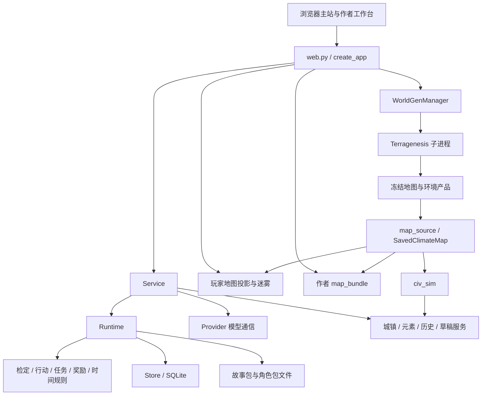

# 织梦工程结构详细报告

日期：2026-11-12。对象：`D:\codexwork\织梦` 当前工作区。

维护补记：本报告保留梳理时的状态快照。同日后续维护已修正 README/模块页中的地图口径、进度页重复项，以及旧启动脚本的绝对路径；最新入口见 [工程进度](工程进度.md) 和 [安装启动](one-click-start.md)。第 11 节相应发现是修复前证据。

本报告依据本轮目录统计、源代码阅读、配置与清单核对、百科库只读查询和测试收集整理。工程当前是一个以 Python/FastAPI、SQLite 和原生浏览器脚本为主体的本地应用，包含玩家叙事运行、作者内容工作台、世界生成与地图产品三大部分。核心规则由本地代码结算，模型参与叙述和作者候选生成。

当前结构已超出早期“文字聊天 Demo”的规模，但各系统进入玩家旅程的程度不同。世界生成、气候水文和作者地图已有独立链路，尚未全部汇入统一的玩家世界模拟。理解工程时，最重要的是区分：作者候选、已发布冻结产品、故事包版本、旅程状态和玩家可见投影。

## 1. 调查范围与结论依据

### 1.1 本轮实际执行

- 检查根目录、主要子目录、Git 状态与最近提交。
- 读取应用入口、HTTP 层、服务层、运行时、存储层，以及地图、生成、文明和前端的主要接入点。
- 对 `app/` 的 176 个 Python 文件进行 AST 解析，未发现语法解析错误。
- 通过 `.venv/Scripts/python.exe -m pytest --collect-only -o addopts='' -q` 收集到 **2938 项测试**，收集成功。
- 使用 SQLite `mode=ro` 查询本地百科库，核对当前分组、元素、历史版本、来源与审核状态。
- 核对作者地图六组数据的目录、manifest 哈希，以及配置中存在的 identity。
- 调用 Terragenesis 桥的轻量探测，确认依赖目录、解释器和 12 个公开模块文件存在；未启动算法导入或计算。

### 1.2 结论边界

本轮没有执行全量测试、启动应用、调用远程模型、重新生成世界或进行浏览器验收。测试收集成功只能证明测试可被发现；manifest 核对通过也不能替代所有数组文件和物理模型的验证。既有文档中的运行耗时与浏览器验收结果属于历史证据，报告在引用时单独注明。

正式旅程库 `saves/textiledream.sqlite3` 本轮未打开，未核对当前启用故事包或实际旅程数量。只读访问的是 `artifacts/human-encyclopedia/encyclopedia.sqlite3`。本轮整理只新增本报告，未迁移目录或修改业务实现。

### 1.3 当前代码与旧文档的几个关键差异

| 项目 | 当前核实结果 | 旧说明容易造成的误解 |
|---|---|---|
| 玩家默认地图 | `world_map_product`，未声明地图时可回退到 Terragenesis 冻结产品 | README 和 `docs/模块.md` 部分段落仍写“只接 civ-atlas” |
| civ-atlas | 默认关闭，需 `TEXTILE_CIV_ATLAS=1` | 早期文档将其列为唯一地图基础 |
| DreamTerra | 仍由 `create_app()` 注册作者路由，玩家地图接口也保留分流 | 模块文档称其只是旁路笔记，低估了现存代码接入 |
| 文明历史 | `preview_civ_sim` 及 review/commit/adopt 链路已有实现 | 进度表中仍混有“尚未采纳接入”的旧描述 |
| 作者地图 | 已登记六组来源，包含 `surface_water` | 进度表较早段落仍写第六组待登记验收 |
| 百科总量 | 本轮现库 53 组、2281 元素 | 551 是部分构库参数范围；2205 是前一天基线 |
| 测试数量 | 本轮收集 2938 项 | README 的 2208 是 2026-11-08 统计 |

发生冲突时，本报告优先采用本轮读取的代码、配置和只读查询。

## 2. 规模与工作区状态

### 2.1 源文件统计

统计包含当前工作区中的已跟踪和未跟踪文件，排除 `__pycache__`、`node_modules` 等缓存目录。行数为包含注释、空行的物理行数；代码文件按 `.py/.js/.cjs/.mjs/.ts/.tsx/.css/.html` 统计，不代表有效逻辑量。

| 范围 | 文件数 | 代码文件数 | 代码物理行 | 说明 |
|---|---:|---:|---:|---|
| `app/` | 680 | 561 | 127464 | 包含后端、静态前端和素材预览代码 |
| `app/` 中 Python | 176 | 176 | 66679 | 根层 91 个 Python 文件，其余位于子包 |
| `app/static/` | 498 | 385 | 60785 | 326 JS、18 CSS、41 HTML，另有素材 |
| `app/world_gen/` | 40 | 40 | 14636 | 世界生成、桥接与阶段适配 |
| `app/world_relief/` | 20 | 20 | 5862 | 地形细化、冻结读取与图册 |
| `app/map_source/` | 7 | 7 | 912 | 统一地图消费接口 |
| `app/civ_atlas/` | 8 | 7 | 3995 | 可选 civ-atlas 后端 |
| `app/civ_sim/` | 11 | 11 | 1955 | 本地文明与社会演化 |
| `tools/` | 125 | 124 | 18505 | 109 个 Python 文件，另有浏览器和 Node 工具 |
| `tests/` | 201 | 201 | 46470 | 197 Python、4 CJS；其中 192 个 `test_*.py` |
| `docs/` | 391 | 28 | 11333 | 另有 164 Markdown、129 JSON；含归档与补丁源码 |
| `DreamTerra/` | 52 | 10 | 1145 | 含证据、测试与历史运行产物 |

`app/` 与其子目录互相包含，不能累加；326 个 JS 中包含素材构件和独立预览脚本，不能理解为 326 个主站业务模块。主页面显式引用 **27 个外部脚本、13 个样式表**。

### 2.2 Git 状态

本轮报告写入前，Git 已跟踪 1339 个文件；已有 80 个已修改文件、52 个删除条目、198 个未跟踪文件。这是按 `git status --porcelain=v1 -uall` 展开的文件级统计。

最近提交为 `523ebf2`，日期 2026-11-08，标题为 `Add future direction evaluation (2026-11-08)`。当前工作区包含此后世界生成、地图、文明和文档整理等大量本地变化，所以本报告描述的是**当前工作区**，并非仅描述该提交，也不证明远端仓库具备相同状态。

## 3. 目录结构与职责

```text
织梦/
├─ app/                         应用主体
│  ├─ main.py                   ASGI 入口
│  ├─ web.py                    FastAPI 装配与大部分路由
│  ├─ service.py                回合协调、模型与作者服务装配
│  ├─ runtime.py                故事包版本、旅程与规则协调
│  ├─ storage.py                SQLite 事务和文档存储
│  ├─ contracts.py / models.py  请求契约和领域数据结构
│  ├─ map_source/               统一冻结地图读取
│  ├─ world_gen/                世界生成与气候水文阶段
│  ├─ world_relief/             地形细节、冻结产品和图册
│  ├─ civ_atlas/                可选上游快照适配
│  ├─ civ_sim/                  自有文明历史生成
│  ├─ prompt_templates/         模型提示词模板
│  └─ static/                   主站、作者 UI、素材和预览页
├─ config/map-bundles.json      作者地图来源登记
├─ StoryPackage/                故事包源文件与知识文档
├─ character_packages/          角色包 JSON
├─ assets/maps/                静态地图资源，挂载到 /maps
├─ DreamTerra/                  另一条有限世界生成和地图接入
├─ tools/                       启动、构库、生成、发布、验证脚本
├─ tests/                       Python 离线回归与浏览器脚本
├─ docs/                        现行规格、素材、补丁和归档
├─ external/civ-atlas/          本地上游源码与前端依赖，Git 忽略
├─ artifacts/                   冻结产品、百科库和验收证据，Git 忽略
├─ saves/                       正式旅程数据库和导入原件，Git 忽略
├─ logs/                        启动和运行日志，Git 忽略
├─ .venv/                       本地 Python 环境
├─ pyproject.toml               项目、依赖、pytest 和 Ruff 配置
├─ requirements.txt / uv.lock   依赖声明与锁文件
├─ launch.py / tools/bootstrap.py / *.cmd
│                              本地与 Windows 启动入口
└─ 历史 Java、TS 与说明占位文件   见第 11 节
```

`dream/`、`story_cards/` 在本轮检查时为空目录。缓存、临时下载、临时输出不承担正式业务模块职责。

## 4. 技术栈、启动和部署形态

| 层次 | 当前技术 | 作用 |
|---|---|---|
| 运行语言 | Python ≥3.11 | 服务、规则、生成适配和工具 |
| Web | FastAPI、Uvicorn | API、静态文件和本地页面 |
| 数据契约 | Pydantic 2 | 请求与结构验证 |
| 模型通信 | httpx + `provider.py` / `ai_protocols.py` | OpenAI 兼容 Chat Completions 与 Anthropic Messages |
| 数据库 | SQLite | 旅程、文档、版本、作者草稿、用量 |
| 数值和图像 | NumPy、SciPy、Pillow | 冻结栅格读取、地形计算、PNG 输出 |
| 模板依赖 | Jinja2 | 已列入核心依赖；主站本体为静态 HTML |
| 主站前端 | 原生 HTML/CSS/JavaScript | 共享 DOM 与 `window` 接口 |
| 可选原生地图宿主 | 上游 React/TypeScript/Vite | civ-atlas 宿主构建 |
| 质量工具 | pytest、Ruff | 回归收集/执行和静态检查 |
| 重型地形内核 | 同级 Terragenesis 工程的独立 Python 环境 | 作者生成子进程 |

常规启动目标为 `app.main:app`。`main.py` 仅导入 `create_app()` 并创建应用；主要装配发生于 `web.py`。`launch.py` 负责日志、端口绑定、就绪检查和浏览器打开；Windows 一键入口经 `tools/bootstrap.py` 处理环境探测与安装。旧 `start_zhiyem.bat` 有开发机 Anaconda 绝对路径，不宜作为可迁移安装入口。

服务按本机使用设计：API 中间件核对主机、Origin 和 `x-textiledream-token`；作者接口及写请求受 token 检查。API Key 保存在 Provider 实例内存中，持久化设置时排除密钥。该结构目前是本地应用形态，没有从当前根目录看到容器编排或 `.github/` CI 配置。

主站不依赖根目录前端构建。根目录 `vite.dream.config.ts` 专门构建 `external/civ-atlas/dist-dream/`，构建结果通过 `/native-map` 提供。主站静态资源和这个可选宿主属于两条不同的交付路径。

## 5. 应用装配、回合流与数据存储

### 5.1 调用关系



`Service` 创建 Runtime、Provider、WorldGenerator、Development、TownService、SpatialDraftService、ElementAssembly、WorldHistoryService、WorldPackagePipeline 和 AIDrafts，承担服务装配及调用协调。`web.py` 还单独装配旧 WorldPipeline、DreamTerra、WorldGenManager 和地图 bundle 路由。

AST 静态统计发现 `app/` 中 188 条显式 HTTP 方法装饰器，DreamTerra 另有 5 条。其中 `app/web.py` 占 172 条。它们是源码声明数，包含条件注册和 router 相对路径，不等同于实际启动后的 OpenAPI 唯一路径数；本轮未创建生产 app 来枚举路由。

### 5.2 玩家回合

1. 浏览器提交行动、台词或其他输入。
2. Service 在短锁内读取旅程，记录 `state_version`。
3. Runtime 根据绑定的故事包版本校验行动，并在候选状态上结算检定、资源、时间和事件变化。
4. Runtime 构造面向玩家的上下文，过滤作者信息与未公开事实。
5. Service 释放锁，调用离线叙述或 Provider；模型接收已裁定的行动结果。
6. 保存前重新检查旅程版本，避免等待模型期间的其他操作被旧状态覆盖。
7. `finish_turn()` 保存回合，返回新的玩家投影。

无进行中事件时的部分本地行动走 `_local_action()`，无需模型调用。规则与叙述已有明确边界：奖励、钱货和状态变化以引擎结果为准。

### 5.3 SQLite 与文件职责

`Store` 以 JSON 文档加少量专用表为主，并未为每种游戏实体建立一组关系表。基础表包括：

| 表 | 职责 |
|---|---|
| `documents(kind,id,body)` | 设置、故事包版本、旅程、作者记录等通用文档 |
| `facts` | 旅程中已确认的信息 |
| `beliefs` | 主体相信的信息 |
| `heard` | 听闻及传播记录 |
| `model_usage` | 独立保留的模型用量记录 |

连接启用 WAL；短写事务和 `expected_version` 检查用于控制并发。包文件与数据库之间的协调另由 `package_transaction.py`、文件锁和 Runtime 恢复逻辑承担。

正式默认数据库位于 `saves/textiledream.sqlite3`；地图导入原件在 `saves/map_imports/`。百科数据库是另一个用途独立的库，当前位于 `artifacts/human-encyclopedia/encyclopedia.sqlite3`。

Runtime 启动时读取 `pointer/package` 决定活动包，不自动启用目录里碰巧存在的故事。已有旅程绑定 revision，包更新不直接替换旧旅程的世界版本。`recall.py` 使用本地稀疏 TF-IDF 和显式同义词进行检索，并非远程 embedding。

## 6. 业务模块划分

| 业务域 | 主要代码 | 当前职责和边界 |
|---|---|---|
| 旅程与版本 | `runtime.py`、`storage.py`、`package_transaction.py` | 包发现/启用/提交、回合、归档、回滚和保存 |
| 事件与剧情 | `events.py`、`event_library.py`、`drama.py`、`endings.py` | 事件候选、事件推进和阶段结局 |
| 属性与检定 | `attributes.py`、`checks.py`、`traits.py` | 属性、特质、服务端检定结果 |
| 行动与旅行 | `adventure_actions.py`、`free_actions.py`、`local_rules.py` | 行动计划、移动、资源与时间成本 |
| 任务与奖励 | `quests.py`、`rewards.py`、`pressure.py` | 任务、奖励和压力进展 |
| 钱货与交易 | `economy.py`、`trade.py` | 交易、钱包、价格及相应规则 |
| 天气 | `weather.py`、`weather_view.py` | 确定性天气与只读预报投影；TG 气候侧车尚未统一接线 |
| 知识和记忆 | `knowledge.py`、`recall.py`、`recap.py`、`state_anchor.py`、`context_stage.py` | 信息分层、召回、压缩及上下文锚点 |
| NPC 与作者辅助 | `npc_cards.py`、`reply_direction.py`、`development.py` | 卡片、台词建议与发展草稿 |
| 模型和提示词 | `provider.py`、`ai_protocols.py`、`prompts.py`、`prompt_templates/` | 协议、模型配置、提示词与请求追踪 |
| 内容候选 | `encyclopedia.py`、`ai_drafts.py` | 可版本化候选库与作者确认 |
| 元素装配 | `element_assembly.py` | 固定元素版本和来源，装配进故事包 |
| 世界内容草稿 | `world_generator.py`、`world_pipeline.py`、`world_setting.py` | 内容蓝图和可编辑阶段草稿 |
| 地理转故事 | `world_source.py`、`world_package_pipeline.py` | 地区快照到作者故事包候选 |
| 城镇 | `towns.py`、`towns_store.py`、`town_schema.py` | 四阶段作者生成、审核、发布 |
| 城镇布局 | `town_plan.py`、`town_layout*.py` | 城镇平面、地形、城墙与建筑布置 |
| 空间草稿 | `spatial_draft.py`、`land_footprint.py` | 建筑范围、空间引用与作者草稿 |
| 历史采纳 | `world_history_store.py`、`world_basis.py` | 历史预览、快照、披露与故事版本绑定 |

这些模块主要按文件协作，只有地图读取、物理生成、文明与 civ-atlas 部分已形成独立子包。`app/` 根层仍有 91 个 Python 文件，目录本身不能完全表达业务边界，需要结合这张表阅读。

## 7. 世界与地图：当前最需要分清的链路

### 7.1 玩家地图与作者地图

| 路径 | 主要入口 | 数据与特点 |
|---|---|---|
| 默认玩家地图 | `play_map.py` → `play_map_world.py` | 从故事 revision 解析 `world_map_product`；米制平面坐标、服务端裁剪、迷雾遮罩 |
| 可选 civ-atlas | `app/civ_atlas/`、`map_import.py` | 导入 `.civsnap`、快照和历史桥接；默认关闭 |
| 作者同源地图 | `map_bundle.py`、`map_bundle_routes.py` | 显式登记的六组冻结来源；图层、月份、点检、窗口和分页矢量 |
| DreamTerra 分支 | `DreamTerra/service.py` | 自有有限世界、道路、故事编译和玩家投影 |
| 作者示意图册 | `app/atlas.py`、`map_render.py` | 故事中的图形、区域和可见性 |
| 地形图册输出 | `app/world_relief/atlas.py` | 从数值地形生成自然总览和专题图 |

玩家地图 GET 不推进旅程版本。迷雾在服务端输出图片前处理，隐藏区域不会作为完整底图交给浏览器。`play_map_world.py` 通过 `ProductCache` 复用已校验冻结产品；文件集合或 stat 变化时使缓存失效。

未显式声明地图时，默认路径为 `artifacts/fast-world/tg-speed-archipelago-1600-20261108`。本轮确认该产品 manifest 存在；可用 `TEXTILE_DEFAULT_WORLD_MAP`、`TEXTILE_DEFAULT_WORLD_IDENTITY` 覆盖。**作者最新登记的地图并不会因此自动变成玩家默认地图。**

### 7.2 `map_source` 统一消费接口

`types.py` 定义 `SourceInfo`、标准图层和协议，`registry.py` 负责 kind/schema 派发，`adapters.py` 处理产品适配，`core.py` 提供查询语义，`cache.py` 处理产品缓存，`catalog.py` 提供目录能力。主要接口是 `sample()`、`crop()`、`vectors()`。

`SourceInfo` 携带 identity、lineage、world_seed、坐标范围、采样间距、栅格形状、图层、单位和限制。缺图层和不支持的 schema 有明确错误，不按文件名猜测格式。注册表兼容 native terrain、tectonic、relief、world-map-product、多个 TD 冻结版本、local30 和 regional climate。

月度产品还需要月份和多维数组语义，因此 `map_bundle` 同时使用 `SavedClimateMap` 等专用消费者，没有强行把所有月数据压成二维 MapCatalog。

### 7.3 世界生成与 Terragenesis

作者作业由 `world_gen/web_jobs.py` 的 `WorldGenManager` 管理，通过子进程执行重型阶段，保存任务状态、日志和产品，可取消、续算或升级精度。同一时刻的生成任务受限制，计算与 API 服务进程分开。

主要职责分布如下：

| 阶段 | 主要模块 |
|---|---|
| 世界配置和预算 | `config.py`、`planner.py`、`estimates.py`、`sysmem.py` |
| 板块与大陆骨架 | `skeleton.py`、`geography.py` |
| 海洋岛链和岛山 | `ocean_island_adapter.py`、`web_island_stage.py`、`island_mountains.py` |
| 快速地形与山地 | `fast_relief.py`、`mountains.py`、`ridge_network.py`、`mountain_sculpt.py`、`world_mountain_stage.py` |
| 局部精细化与 TD | `local30.py`、`td_coarse.py`、`web_td_stage.py`、`world_relief/` |
| 水网与湖盆 | `graph_hydro.py`、`river_flow_network.py`、`lake_basin_geometry.py`、`world_hydrology_stage.py` |
| 气候与环境 | `climate_world_stage.py`、`world_climate_adapter.py`、`climate_environment_stage.py` |
| 雪冰和年水文 | `glacier_stage.py`、`climate_hydrology_stage.py` |
| 月湖河库存 | `climate_lake_stage.py`、`csr_reservoir_adapter.py`、`csr_reservoir_year.py`、`surface_water_map.py` |
| 洋流专题 | `ocean_current_overlay.py` |
| 过程产物绑定 | `world_process_adapter.py`、`world_process_details.py` |
| 外部内核边界 | `terragenesis_bridge.py` |

以上为职责地图，并不表示每次作者作业都会依次执行全部阶段。部分后续气候、水文和发布任务由 `tools/` 显式运行，产品再交给消费者读取。

Terragenesis 位于同级工程 `D:\codexwork\山川形意Terragenesis`，解释器为其 `runtime/venv/Scripts/python.exe`。本轮原生探测确认解释器和公开模块文件均存在。它并非主仓的 pip 依赖；换机器时只安装本仓 requirements 不能重建完整生成环境。

`world_relief/` 内有 `td_freeze.py` 至 `td_freeze_v6.py` 等冻结格式处理代码。它们同时承担已有产物兼容职责，不能仅因版本较旧就当作可删除的重复实现。

### 7.4 当前登记的六组同源产品

登记文件：`config/map-bundles.json`。当前 bundle：`terragenesis-world-20261111`。

| 来源 | 产品路径（仓库相对） | schema |
|---|---|---|
| terrain | `artifacts/mountain-glacier-hydrology-20261111/world` | `world-map-product-v1` |
| environment | `artifacts/world-climate-integration-20261111/environment-world` | `world-map-product-v1` |
| climate | `artifacts/world-climate-integration-20261111/climate-dry-continuous-year` | `terragenesis-regional-climate-v1` |
| hydrology | `artifacts/world-climate-integration-20261111/hydrology-dry-continuous-year` | `dream-climate-hydrology-year-1` |
| ocean | `artifacts/ocean-current-overlay-20261111` | `dream-ocean-current-overlay-1` |
| surface_water | `artifacts/climate-lakes-rivers-20261112/surface-water-csr-year` | `dream-climate-lake-year-1` |

本轮六组 manifest 的 SHA-256 均与配置匹配；配置声明非空 identity 的产品，其 identity 也匹配。ocean 的 registry identity 为 null，另有 forcing identity 与字段哈希，本轮未将 null 当作产品 identity 通过证明。

作者 API 提供 bundle 列表/详情、PNG、点值、格窗查询和分页矢量。这些来源仅用于作者读取，登记动作不改故事、不切换默认地图、不启动物理生成。

根据既有进度记录：当前全域地形为 10000×8000 km、10 km 格距；气候年链使用 365 日工程情景，洋流为独立 40 km 有限年候选；月湖河为 800×1000 全域的 12 月产品。这些产品仍保留极干气候、有限冰川支持、原 routing 拓扑、空初始库存、PET 代理和月步离散等限制。**文件齐全和界面可读，不等于自然气候、永久湖面或长期水量已经验证。**

### 7.5 文明、历史、城镇与故事的连接

`civ_sim/` 读取冻结地图，在粗栅格州上进行立国、扩张、战争和灭亡；可选社会层生成王朝、人物、任命和国祀。文明种子与地形种子分开，不改地形，也不调用 TG 重算。

输出经 `history_bridge.py` 转为候选，通过 `WorldHistoryService.preview_civ_sim` 进入既有 page/review/commit/adopt 流程，最终以 `mechanics.history` 固定到故事版本。`/api/inner/history/civ-sim/previews` 是作者入口之一。代码接线存在不代表本机某份历史已被实际采纳；本轮未查询正式存档。

城镇四阶段、平面布局和空间草稿是另一组作者服务，尚不能把现状概括成“文明自动生城镇，城镇经营自动参与玩家回合”。`building_economy.py` 主要提供经营标记和结构，完整产量、经营平衡和统一回合结算仍待接线。

## 8. 内容、百科和故事包

### 8.1 内容到玩家状态的层次

```text
docs 中的源 JSON / 采集 Markdown
        ↓ 构库、overlay、版本与来源记录
百科候选库
        ↓ 作者选择精确版本、确认候选与披露范围
故事包 mechanics.element_manifest / 固定快照
        ↓ 新旅程绑定故事 revision
旅程状态、检定、物品和任务
        ↓ 角色、地点、标记及公开白名单过滤
玩家可见内容与模型上下文
```

采集完成、导入百科、采纳进故事和实现可执行规则是不同步骤。自然语言描述或百科 `requires` 文本不会自动成为检定、配方、法术或生产规则。

### 8.2 本轮百科库实查

| 指标 | 当前值 |
|---|---:|
| groups | 53 |
| 当前 elements | 2281 |
| element_versions | 4870 |
| 当前 sources | 1696 |
| source_versions | 1701 |
| `review_status=needs_review` | 2281 |
| `detail_status=needs_detail` | 2281 |
| fantasy-affixes 当前元素 | 71 |

这组值来自 2026-11-12 的现库只读查询；它与 2026-11-11 的 baseline 反映不同时间点。所有当前元素均仍待审、待补详情，不能因入库或有来源就视为逐条事实核验完成。历史版本数量不能和当前元素数量相加。

新一轮全领域采集规范位于 `docs/element-database/`，覆盖定义、结构、基线和 60 个专题采集清单。该目录的采集文件仍是候选材料，不能按 Markdown 文件数推算入库元素或可玩规则数。

### 8.3 本地故事包

本轮发现 5 个含 `story.json` 的故事包目录、5 个角色包 JSON。

| 故事标识 | 地点数 | 事件数 | 主要特征 |
|---|---:|---:|---|
| `short_tavern`，位于 `world_short_tavern/` | 3 | 4 | 属性、本地规则、场景裁定、起点与结局 |
| `short_market` | 3 | 4 | 同类短场景结构 |
| `short_bridge` | 3 | 4 | 同类短场景结构 |
| `native_ns_ad73661dd8054c38` | 50 | 0 | 显式 civ-atlas 地图、旅行与探索配置 |
| `native_ns_38e78b7476af4514` | 50 | 0 | 显式 civ-atlas 地图、旅行与探索配置 |

有些源包没有显式 `mechanics.map`，运行时可能按策略使用默认冻结产品。两个 civ-atlas 包则受开关控制。目录存在与当前启用是两回事，实际启用状态由存档 pointer 决定。

## 9. 前端与素材组织

当前主界面由 `index.html`、`app.js`、`play-ui.js` 和主题样式组成。页面包含工作区侧栏、作者工作台、地图、可收起的故事手记、旅程列表和信息卡。旧界面 DOM 仍保留在隐藏的 `#legacy` 中，方便既有脚本复用。

| 前端模块 | 作用 |
|---|---|
| `app.js`、`play-ui.js` | 全局启动、状态更新、主交互和界面协调 |
| `playable-demo.js`、`dice.js` | 场景行动、检定交互和骰子表现 |
| `map-bundle.js`、`native-map.js`、`map-fog.js` | 作者产品图层、地图宿主与迷雾 |
| `worldgen.js` | 作者生成作业参数和状态 |
| `world-workshop.js`、`generators.js` | 作者世界工作台与生成入口 |
| `towns.js`、`town-plan-ui.js` | 城镇草稿与布局预览 |
| `element-assembly.js`、`ai-drafts.js`、`world-setting.js` | 元素装配、候选和世界设定 |
| `world-history.js`、`spatial-planner.js` | 历史候选与空间草稿 |
| `npc-cards.js`、`exploration-ui.js` | NPC 与探索界面 |
| `map-art/`、`item-art/` | SVG/JSON 图集、城镇构件和图标 |
| `weather-fx/` | 独立天气画面预览 |

主站以普通 script 的加载顺序、共享 DOM id、全局对象和事件协作，没有统一模块构建或类型检查。当前最明显的维护约束是脚本之间的隐式依赖和新旧 DOM 并存；简单移动文件或调整加载顺序可能影响其他面板。

素材目录中有大量生成脚本、构件定义与预览页。它们一部分是生产所需资源，一部分是美术验证入口，因此前端行数与玩家功能规模不能直接对应。

## 10. 工具、测试与验证现状

### 10.1 tools 分类

| 用途 | 示例 |
|---|---|
| 启动和环境 | `bootstrap.py`、`serve_for_probe.py` |
| 百科构库和覆盖字段 | `encyclopedia_build.py`、`encyclopedia_cli.py`、`encyclopedia_merge.py`、`catalog_overlay.py`、`affix_fields.py` |
| 世界准备 | `generate_world_skeleton.py`、`prepare_island_mountains.py`、`build_fast_relief.py`、`prepare_local30.py` |
| 气候和水文 | `prepare_climate_world.py`、`prepare_climate_hydrology.py`、`prepare_csr_reservoir_year.py` |
| 发布和登记 | `publish_climate_environment.py`、`publish_mountain_glacier_world.py`、`register_map_bundle.py` |
| 图册和专题 | `render_world_relief_atlas.py`、`render_surface_water_map.py`、`render_ocean_current_overlay.py` |
| 文明运行 | `run_civ_sim.py` |
| 浏览器探测 | `*_probe.cjs`、`*_ui_check.*`、`dream_*.*` |
| 模型成本和长对话 | `price_audit.py`、`million_context_benchmark.py`、`token_usage_report.py` |
| 早期内容修订工具 | `prepare_demo.py`、`expand_world.py`、`build_knowledge_package.py` |

工具目录兼有可复用命令、阶段发布器、开发实验和历史一次性脚本，不能假设每个工具都适用于当前内容结构。例如部分旧脚本仍引用已不存在的 `world_packages/` 路径。

### 10.2 测试覆盖组织

测试覆盖旅程保存与版本、检定、事件、奖励、交易、起点、百科、元素装配、地图导入、玩家投影、城镇、天气、世界阶段、气候水文、图册和文明历史。FastAPI TestClient 的测试、纯 Python 测试、Node 行为脚本与浏览器脚本并存。

`pyproject.toml` 的默认 pytest 路径仅为 `tests/`，因此本轮 2938 项并不包含整个仓库所有可能的测试入口，例如 `DreamTerra/tests/`、上游测试和独立浏览器脚本。

`tests/conftest.py` 与 `tests/__init__.py` 会默认设置 `TEXTILE_CIV_ATLAS=1`，让旧 civ 测试继续运行；生产默认值仍是关闭。解读测试结果时必须区分这两个环境。

本轮收集过程出现 Starlette/httpx 的弃用警告，未导致收集失败。未执行 Ruff 或 JS 语法检查，因此不声明它们在当前工作区通过。历史报告中的定向测试和真实浏览器结果也不合计为当前全量通过数。

## 11. 结构问题与整理优先级

以下是依据本轮证据提出的整理建议，不是已经执行的重构。

### 11.1 优先澄清文档和入口

1. **统一地图与现状表述。** README、模块页、进度页已经出现默认后端、DreamTerra 接入和文明采纳状态冲突。可先修这三个入口，再链接专项规格。
2. **明确“玩家默认”和“作者当前世界”的关系。** 最新 bundle 与默认 speed 产品指向不同目录，UI 和交接文档应持续显示具体来源。
3. **保留数据统计的日期与范围。** 551、2205、2281 都有各自范围或时间点；测试收集数也会变化，不能用一个历史数字充当永久总数。
4. **给工具补用途标识。** 区分当前入口、手动发布、实验和历史脚本，首先标明仍引用 `world_packages/` 的旧工具。

### 11.2 逐步收拢代码边界

| 位置 | 规模 | 维护含义 | 建议方向 |
|---|---:|---|---|
| `world_relief/atlas.py` | 2371 行 | 多种图层与表现集中 | 按实际专题拆出渲染职责，保留统一入口 |
| `checks.py` | 2056 行 | 核心检定规则集中 | 先稳定公开检定契约，再按规则阶段拆分 |
| `runtime.py` | 2051 行 | 包版本、旅程和规则协调集中 | 优先分离包管理与旅程协调 |
| `towns.py` | 2022 行 | 多阶段城镇业务集中 | 围绕阶段输入输出形成明确模块 |
| `encyclopedia.py` | 1872 行 | 数据结构、存储与查询集中 | 将公共契约与存储实现分层 |
| `web.py` | 1673 行、172 条声明路由 | 业务域装配较集中 | 延续 `map_bundle_routes` 的 router/install 方式迁出路由 |
| `world_gen/web_jobs.py` | 1277 行 | 作业、资源检测、阶段命令与摘要集中 | 按作业状态、阶段构建和产品摘要逐步收拢 |

文件较大本身不证明存在故障。拆分应以减少跨域依赖和稳定调用接口为目标，不宜只按行数均分。

### 11.3 历史文件与兼容实现要分别处理

- 根目录 `ConstructionExecutor.java`、`VillageEconomy.java`、`WorkManager.java` 使用 Minecraft 包与类型；当前根目录未见对应 Gradle/Maven 构建入口，也未见主 Python 应用调用，可按历史参考单独标注。
- 根目录 `bridge.ts`、`generate.ts` 使用上游相对 import，当前 Vite 入口则在 `external/civ-atlas/src/dream/entry.tsx`。根部文件不应被误认为可独立运行的主站模块；后续归档前应核对补丁镜像关系。
- `app/engine.py` 的旧加载器仍指向 `world_packages/玄陆_世界包.json`，当前主链采用 Runtime；本轮搜索未发现主应用通过旧 engine 加载故事。但 `models.py` 仍被 Runtime 引用，不应连带整体删除。
- `app/civ_atlas_history.py`、`civ_atlas_snapshot.py` 等旧路径目前是兼容 shim；它们与完全无引用的历史文件不同。
- `DreamTerra/` 不能仅凭旧文档改名或移走：`web.py` 仍直接导入，并在玩家地图请求中优先检查相应上下文。
- 多版 `td_freeze*` 兼容已保存产品，清理需要核对产品 schema 和现有消费者。

### 11.4 可复现交付仍依赖本地状态

本机最新世界、百科库、验收证据大多位于 Git 忽略的 `artifacts/`；正式数据位于忽略的 `saves/`；civ-atlas 源码和依赖在忽略的 `external/`；Terragenesis 又位于主仓外。`config/map-bundles.json` 记录来源，不能代替这些实际文件。

因此，单独克隆主仓并安装 requirements 不能还原本机全部能力。后续交付宜分别列清：主站最小启动要求、读取已有地图所需产品、重新生成所需外部内核，以及可选 civ-atlas 构建。

`pyproject.toml` 的 setuptools 包列表目前显式列出 `app` 与 `DreamTerra`，没有在配置中展开新子包，也没有看到完整静态资源打包声明。本轮未构建 wheel，不能断言安装产物的完整性；如果准备采用 wheel 分发，应专项核对新子包、模板与 static 是否被带入。

### 11.5 尚未闭合的玩法链路

按现有实现和工程进度记录，仍需单独完成或验收的连接主要包括：

- TG 气候侧车到旅程天气的统一读取。
- TG 地图上的陆路寻路与道路网络；现有作者 `adventure.routes` 不等于从地形推导道路。
- 新世界层、城镇布局、天气画面和经营结算在同一旅程中的整合。
- 玩家正式地图多边形圈选。
- civ-atlas 按年历史回放和原生宿主玩家模式。
- 多年湖泊库存、常年河流和自然湖面验证。
- 全量货币文案和内容字段向整数铜币、公制约定的一致迁移。

这些是具体能力边界，不能用“模块文件已存在”替代完成验收。

## 12. 建议的阅读与后续整理顺序

新接手工程可以按以下顺序建立理解：

1. `main.py` → `web.py:create_app` → `service.py`：了解应用装配、页面和主要服务。
2. `runtime.py` → `storage.py` → `contracts.py/models.py`：了解故事版本、旅程和保存方式。
3. `checks.py`、`adventure_actions.py`、`rewards.py`、`local_rules.py`：理解规则如何实际改变世界。
4. `map_policy.py` → `play_map.py` → `play_map_world.py` → `map_source/`：确认玩家地图来源和信息过滤。
5. `config/map-bundles.json` → `map_bundle.py` → `map_bundle_routes.py` → `static/map-bundle.js`：理解作者当前世界。
6. `world_gen/web_jobs.py` → `terragenesis_bridge.py` → 目标阶段及发布工具：理解生成和消费的边界。
7. `encyclopedia.py` → `element_assembly.py` → `world_history_store.py` → `civ_sim/`：理解内容与历史如何成为故事版本。
8. 需要改 UI 时再从 `index.html` 核对脚本顺序、DOM id、共享对象和相关浏览器脚本。

建议先完成低风险的信息整理：统一入口文档、注明旧工具、列清产品与外部依赖。随后按一次具体功能改动逐步收拢路由、包管理和前端依赖，每次保持现有故事 revision、冻结产品 schema 和玩家投影行为可验证。

## 13. 参考入口

| 主题 | 入口 |
|---|---|
| 现行进度 | [工程进度.md](工程进度.md) |
| 原模块说明 | [模块.md](模块.md) |
| 专项规格索引 | [文档地图.md](文档地图.md) |
| 玩家地图策略 | [map-backends.md](map-backends.md) |
| 作者地图接入 | [world-map-integration-handoff-20261111.md](world-map-integration-handoff-20261111.md) |
| 世界算法分工 | [terrain-algorithm-map.md](terrain-algorithm-map.md) |
| 统一地图消费契约 | [world-map-source-contract.md](world-map-source-contract.md) |
| 文明生成与历史采纳 | [civ-sim.md](civ-sim.md) |
| 元素库规范与采集 | [element-database/README.md](element-database/README.md) |
| 前一天百科基线 | [element-database/baseline.md](element-database/baseline.md) |
| 月湖河既有验收 | [本批 README](../artifacts/climate-lakes-rivers-20261112/README.md) |
| 安装与许可 | [README](../README.md)、[THIRD_PARTY_NOTICES](../THIRD_PARTY_NOTICES.md) |

`artifacts/` 链接仅在拥有相应本地产物的工作区可用。归档文档位于 `docs/archive/`，本轮未以其历史方案替代当前实现。
