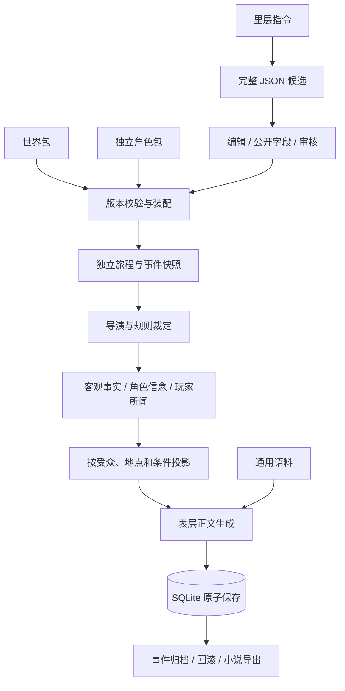

# TextingDream · 当前实现

双击启动织梦.cmd，服务就绪后自动打开浏览器。默认端口占用时会自动选择空闲端口。启动器使用已验证的 D:\anaconda\python.exe。

## 使用顺序

1. API 配置：填写 DeepSeek 地址、模型和 Key，关闭离线模式，保存后测试连接。无 Key 可以运行离线事件链。
2. 新的旅程：使用最新故事包版本创建独立存档；支持主角、旁观者和混合模式。
3. 表层对话：输入意图，通过关键操作推进事件。结束事件后从地图移动。
4. 里层创作：生成完整 JSON 候选，编辑公开字段及条件，批准为新版本。旧存档保持原版本，新旅程使用新版。
5. 设置：主题、字号、上下文预算、通用语料。归档可回滚到事件起点，也可导出、润色小说。

## 模块

| 文件 | 职责 |
|---|---|
| launch.py | UTF-8 启动日志、端口冲突处理、浏览器就绪检查 |
| app/main.py、app/web.py | 应用入口、HTTP 路由、同源检查、表层与作者接口隔离 |
| app/contracts.py | 严格 API 请求结构与模型生成候选结构 |
| app/service.py | 模型调用、失败时不提交状态、离线示例、归档润色 |
| app/runtime.py | 故事与角色装配、版本、导演、操作、检定、记忆检索、可见性、回滚 |
| app/storage.py | SQLite 事务与连接关闭、独立 facts/beliefs/heard 表 |
| app/provider.py | DeepSeek 兼容接口、JSON 输出、超时、错误、调用用量 |
| app/static/ | 左侧导航和五个页面 |
| world_packages/、character_packages/ | 初始故事包与独立角色包 |
| assets/maps/ | 下载的 Natural Earth 地图数据、SVG、许可 |
| data/textiledream.sqlite3 | 正式存档、版本、候选、设置与通用语料 |
| tests/test_runtime.py | 状态原子性、重载、回滚、信息隔离、模型协议测试 |
| tools/browser_check.py | 独立临时数据库上的真实 Edge 页面交互测试 |

早期 app/engine.py 留作兼容参考，不参与新应用运行。早期审查文档描述的是原型阶段，以本说明为准。

## 已连接的数据流

## 实际规则

- 导演支持事件前置标记、地点、时间窗、后继节点、操作条件、完成出口与最大轮数。
- 移动只允许相邻地点，时间、位置和探索标记同事务保存。旁观者移动的是观察焦点。
- 白名单状态操作：标记、取得在场物品、客观记录、传闻传播、短期状态偏移。自由输入不能直接授予物品或能力。
- 关键检定由种子、事件和操作 ID 决定；审计保存属性、疲劳、掷骰与结果。回滚重做可复现。
- 一事件对应多轮独立对话和起点快照；结束生成表层摘要，下一事件不注入全部历史。
- 客观事实、信念、所闻独立存储；传闻从客观记录执行数字缩放或片段截取，保存来源与失真度。角色会据错误信念改变反应。
- 反应按性格权重与当前状态排序，正文显示内心声音及无数值状态标签。事件可配置 special_branches，按物品或已闻记忆触发专属台词。
- 表层接口不返回隐藏目标、事实表、种子和性格数值。角色模型上下文不包含玩家全量对话。
- 候选批准和包版本写入是单次事务；重复批准、过期候选与非法引用被拒绝。
- 普通对话最多一次模型调用，里层生成最多一次，润色单独点击。用量在里层审计中查看。
- 小说导出按事件连续排列；润色文本独立保存，不覆盖原始事件或世界状态。

## 边界与后续内容扩展

以上为最小可运行实现。自由文本世界硬规则的语义一致性仍由作者审核，不是任意自然语言规则的自动证明器。关键动作采用结构化按钮，模型只为已经裁定的结果写正文。

记忆检索使用文本关联度、强度和新鲜度排序；失真支持片段与数字变换，并非复杂情绪记忆模拟。摘要采用裁剪后的表层正文；上下文预算是字符上限而非精确 token 数。

初始 JSON 仅在数据库首次建立时导入；后续从里层编辑、导入导出正式版本。直接修改模板不覆盖数据库，已有旅程也不受新包版本影响。

这是本机单作者工作台，侧边栏是视图切换，不是多用户登录权限。作者主动进入里层可以查看秘密；玩家接口和表层模型只使用投影。无法保证模型绝不产生事实幻觉，所以正文不能反向改写权威状态。

Key 只保存在当前服务内存，不写数据库、不回传。重启后重新填写或通过环境变量提供。真实 DeepSeek 连接需要有效 Key 和余额；本次测试为离线全流程及模拟 HTTP 协议测试，未冒充真实远程调用。

地图使用 Natural Earth 公共领域数据，亚欧非同图，下载后可离线查看。地点是测试坐标，架空势力边界需要后续资料。
