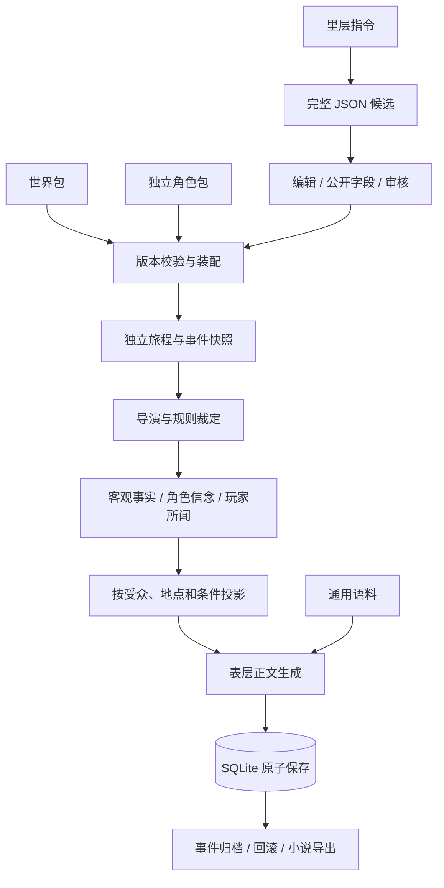

# TextingDream · 当前实现

双击启动织梦.cmd，服务就绪后自动打开浏览器。默认端口占用时会自动选择空闲端口。启动器使用已验证的 D:\anaconda\python.exe。

## 使用顺序

1. API 配置：填写 DeepSeek 地址、模型和 Key，关闭离线模式，保存后测试连接。无 Key 可以运行离线事件链。
2. 新的旅程：使用最新故事包版本创建独立存档；支持主角、旁观者和混合模式。
3. 表层对话：输入意图，通过关键操作推进事件。结束事件后从地图移动。
4. 里层创作：生成完整 JSON 候选，编辑公开字段及条件，批准为新版本。旧存档保持原版本，新旅程使用新版。
5. 设置：主题、字号、上下文预算、通用语料。归档可回滚到事件起点，也可导出、润色小说。
6. 元素装配：先构好候选库（`python -m tools.encyclopedia_build`），再到「◆ 元素装配」页检索、查看固定版本详情、逐条确认并加入清单；校验后一次锁定进故事包。开局后旅程只读包内快照。

## 模块

| 文件 | 职责 |
|---|---|
| launch.py | UTF-8 启动日志、端口冲突处理、浏览器就绪检查 |
| app/main.py、app/web.py | 应用入口、HTTP 路由、同源检查、表层与作者接口隔离 |
| app/contracts.py | 严格 API 请求结构与模型生成候选结构 |
| app/service.py | 模型调用、失败时不提交状态、离线示例、归档润色 |
| app/runtime.py | 故事与角色装配、版本、导演、操作、检定、记忆检索、可见性、回滚 |
| app/storage.py | SQLite 事务与连接关闭、独立 facts/beliefs/heard 表 |
| app/rewards.py | 本地奖励：严格配置、白名单派生、确定性生成、批次原子应用与公开投影 |
| app/town_schema.py、app/towns.py | 城镇 V1：严格输入与四阶段结构、确定性规则生成、跨阶段校验、公开/作者投影 |
| app/towns_store.py | 城镇草稿→不可变版本→采纳进故事包；发布与采纳各自幂等 |
| app/element_assembly.py | 元素装配：受限库访问、选择清单草稿、清单构建/校验（版本固定、typed 规则、上限）与公开/作者投影 |
| tools/encyclopedia_build.py | 按显式 12 组名单可复现生成候选库（幂等；应用启动不建库） |
| app/provider.py | DeepSeek 兼容接口、JSON 输出、超时、错误、调用用量 |
| app/static/ | 左侧导航与页面（含元素装配、城镇创作）；数据一律用 textContent 写入 |
| world_packages/、character_packages/ | 初始故事包与独立角色包 |
| assets/maps/ | 下载的 Natural Earth 地图数据、SVG、许可 |
| data/textiledream.sqlite3 | 正式存档、版本、候选、设置与通用语料 |
| tests/test_runtime.py | 状态原子性、重载、回滚、信息隔离、模型协议测试 |
| tests/test_towns.py | 城镇确定性、三地差异、零写入拒绝、阶段失效、并发 CAS、发布/采纳幂等、旧新旅程隔离、不泄密 |
| tests/test_towns_review.py | 已知范围（当前/已探索/邻近/未绑定）、三轴可见性与私区子设施、公开警告不带内部信息，以及九类恶意阶段编辑 |
| tests/test_towns_round2.py | 单位/周期绕过、出口累计超额、进口额度重复吃满、燃料来源（未勘探煤/零额度进口/自我依赖） |
| tests/test_towns_deps.py | 资源依赖有界闭包：木→煤→铁解链、无起点循环不自举、生成器与校验器共用同一份 |
| tests/test_towns_units.py | 手写字面值的口粮基准（1 人 180 000 g、1 000 人 180 t、180 t 进口约 1 000 人）与 kg 缩放回归 |
| tests/test_element_assembly.py | 库路径策略、检索/版本与来源固定、选择类型与白名单、typed 规则、上限与篡改、投影与预算 |
| tests/test_element_assembly_integration.py | 提交幂等/陈旧拒绝/失败零写入、旧旅程锁版、导出空库、真实 provider payload、生成器与流水线保留清单、城镇绑定越界 |
| tools/browser_check.py | 独立临时数据库上的真实 Edge 页面交互测试 |

早期 app/engine.py 留作兼容参考，不参与新应用运行。早期审查文档描述的是原型阶段，以本说明为准。

## 已连接的数据流

## 实际规则

- 导演支持事件前置标记、地点、时间窗、后继节点、操作条件、完成出口与最大轮数。
- 移动只允许相邻地点，时间、位置和探索标记同事务保存。旁观者移动的是观察焦点。
- 白名单状态操作：标记、取得在场物品、客观记录、传闻传播、短期状态偏移。自由输入不能直接授予物品或能力。
- 关键检定由种子、事件和操作 ID 决定；审计保存属性、疲劳、掷骰与结果。回滚重做可复现。
- 一事件对应多轮独立对话和起点快照；结束时按起点快照与当前状态的差分确定性生成结构化摘要（事件 / 经过 / 状态层已确认记录 / 变化 / 原文摘录段），下一事件只注入它，不注入全部历史。
- 客观事实、信念、所闻独立存储；传闻从客观记录执行数字缩放或片段截取，保存来源与失真度。角色会据错误信念改变反应。
- 反应按性格权重与当前状态排序，正文显示内心声音及无数值状态标签。事件可配置 special_branches，按物品或已闻记忆触发专属台词。
- 离线模式不拼内部提示：引擎把反应决策转成一段结构化的公开表现（在场角色、public_name、动作、情绪、立场），再映射为一句简短自然的可见动作；正文不含 personality 权重、secret、内部 cue 指令，也不宣称理解玩家输入。只有 `speech` 回合或已执行的动作才会渲染成对话式反应；thought/note 只描述可观察的样子，observer 模式不代主角第一人称发言。special_branches 的专属台词照常保留。在线 reactions 协议不变，仍带 cue 供模型参考。
- 表层接口不返回隐藏目标、事实表、种子和性格数值。角色模型上下文不包含玩家全量对话。
- 候选批准和包版本写入是单次事务；重复批准、过期候选与非法引用被拒绝。提交失败时候选不会被标为已批准，可修正后重新提交。
- 普通对话最多一次模型调用，里层生成最多一次，润色单独点击。用量在里层审计中查看。
- 小说导出按事件连续排列；润色文本独立保存，不覆盖原始事件或世界状态。

## 本地奖励：物品实例、金币与能力

- 配置在 `story.mechanics.rewards`（`app/rewards.py`，严格 Pydantic）。**不配置时整条链路与旧版完全一致**：不新增状态键、surface/context 不出现奖励字段、`op=reward` 被拒绝。示例片段见 `docs/examples/rewards-demo.story-fragment.json` 与同名说明；它只是可合并的示例，不会改动 `StoryPackage/玄陆`。
- 派生只走白名单整数运算（`base * percent // 100` 与加法）：重量、耐久、伤害、价值、魔力容量。没有公式求值器、没有模型调用、没有 `eval`。`hidden: true` 的附魔**不参与玩家可见的伤害与价值**，所以玩家无法从数字反推它的存在；耐久与魔力容量本版是静态值，没有损耗、修理或充能。
- 确定性只用 SHA-256 计数流，种子为「旅程 seed + 本轮事件分支键 + 奖励条目 + 来源动作」；不用 Python `hash()`、不读时钟。因此回滚到事件起点后重做同一动作，得到**完全相同**的物品与金额。
- 分支键 `active.key` 由 seed 与「该节点已归档次数」推出，与对话轮数无关；旧存档缺这个字段时按同一规则重新推导，不需要迁移写库。
- 状态全部在旅程快照 `session['rewards']` 内（钱包、物品实例、能力、grants、ledger），由既有 `Store.save_session` 单事务保存，不另建索引表，因此没有第二权威：回滚、重载、导出都随存档一起走。只读投影（surface/context/记录簿）**不写库**，GET 不会偷偷提交。
- 一批奖励先整批模拟到深拷贝上（含累计余额、事件内 grants 上限、能力前置与标记、单件价值上限、物品数量上限），全部通过才一次性写回；任一条失败则整批拒绝，不会留下半批。奖励与旧 effect 混在同一批时也在拷贝上完成，后面旧 effect 失败不会让调用方候选状态半更新。
- 幂等：`grant = sha256(seed:来源动作:条目)`。同一条来源动作不会重复发放（重试、事件结束后再调用也不行）；回滚撤销该分支的 grants 后重做，按同一规则重获。
- 资金来源是**引擎奖励源**。奖励条目可用 `payer` 引用作者声明的 `accounts` 账户（同币种），在同一批里扣款，余额不足则整批拒绝；账户只在作者视图可见。本版没有 NPC 资金、商店库存或世界稀缺模型，不宣称 NPC 已经付过钱。
- 信息边界：`inventory` 字符串列表保持原样兼容；新增的 `surface.rewards` 只给公开投影。`identified=false` 的物品只暴露可观察标签与重量，不给伤害/价值/耐久/材质/品质/附魔，也不给模板名；隐藏附魔即使已鉴定也不出现在玩家投影与摘要里，`public=false` 的能力不出现。作者接口 `GET /api/inner/rewards`（可带 `session`）才看得到完整实例、隐藏附魔、付款账户与账本。公开投影的物品数值标为 `visible_estimate`（只含可见部分，不是裁定值）；本版没有战斗、负重或交易执行器，数值仅供叙述。奖励表与奖励条目共用声明入口，因此二者 ID 不允许相同（提交时拒绝）。付款账户的扣款以 `account` 字段记入作者侧 grants/ledger，玩家投影没有该字段。
- `context['resolved_action']` 是剥离了 `reward_audit` 的公开结果，模型的输入里没有内部前后值、实例 ID 与缓存；NPC 视角不继承玩家的钱包、物品与未公开能力。
- 摘要的【变化】只按公开投影做差（含「物品 +…（未鉴定）」），只覆盖配置奖励，不虚报血量等旧 effect 的数值。
- 前端只在既有「我的属性与当地环境」里加一段公开钱货/随身物品，全部用 `textContent`；未配置奖励时不渲染这一段。

## 故事包保存事务

- 一次提交 = 写日志 → 复制到暂存目录 → 在暂存目录写故事与角色包 → 换目录 → 写数据库 → 清理旧副本。日志（`StoryPackage/.package_transaction.json`）是唯一在途记录。
- 日志以 `O_EXCL` 独占创建：两个提交不会同时认为自己持有事务，残留日志必须先重放才能开始新提交。
- 日志里的每个路径（含 `character_file`/`character_backup`）都按名称规则、根目录约束和符号链接逐项校验，**全部校验通过后**才动任何文件；损坏或恶意的日志原样保留并直接报错退出（fail closed），不会移动或删除任何文件。
- 恢复可重复执行：以「数据库指针是否已指向新版本」判定提交与否，其余全部由磁盘现状推断。`backup` 存在说明换目录已发生，把它移回即消耗标记，因此上一次恢复中断后不会在下次误删已恢复的目录；角色包备份同理。
- 阶段标记在破坏性动作**之前**写入，中断只可能留下「标记已写、动作未做」，重放是无害的 no-op，不存在「动作已做、标记没写」的窗口。
- 提交完成后的清理失败不回滚：数据库与磁盘保持新版本，日志留着，下次启动按「已提交」只重试删除，并给出提示。
- 清理前先按**已提交的包文档**校验新目录：`story.json` 可解析且 id/title 与提交版本一致、`总概.md` 存在、提交版本的每个知识点文档都在、角色包 ID 一致。校验不过就保留备份与日志并报错，不会因为「有个 story.json」就删掉恢复点。
- 角色包备份用「写临时文件 + 一次 rename + fsync」生成，中途失败只留临时文件，不会留下半截备份；恢复时若备份不是合法 JSON 也拒绝使用并保留原件。
- 进程内 `BaseException` 只会触发同进程回滚，这不是模拟进程死亡；真正的掉电/被杀场景由上面的磁盘状态与日志推断覆盖（测试里直接布置磁盘中间态再重建 Runtime 验证）。
- `atomic_text` 用唯一临时名写入、fsync 后 rename、再 fsync 目录，因此进程中断不会读到半截文件；这只针对进程中断，不承诺物理掉电绝对安全。
- 暂存写入拒绝含符号链接的目录树（复制用 `symlinks=False` 并额外全树检查），避免暂存写入经链接写到用户的其它文件。
- 可编辑的故事包目录与旧旅程版本绑定语义保持不变：新版本写回原目录，旧旅程继续持有自己的 revision。

以上仅覆盖**本机单作者**模式：日志在同一进程内串行化提交，不实现多进程在线编辑同一个故事包，也不做跨机器的分布式锁。

## 城镇生成 V1：四阶段固定规则

- 入口：侧边栏「城镇创作」，或作者接口 `/api/inner/towns*`（沿用既有 token）。完整说明、边界与三个预置样本见 `docs/examples/town-使用说明.md`，设计记录见 `TOWN_GENERATION_V1_PLAN.md` 第 10 节。
- **不调用语言模型**。结构与数值全部来自作者输入 + `app/towns.py` 的固定规则表；同一世界版本、输入、社会档位与 seed 得到同一座城镇，**包括每个实体 ID**（只用 SHA-256 计数流，不用 uuid/时钟/`hash()`）。
- 四阶段：骨架 → 社会经济 → 建筑与特殊地点 → 故事候选。每阶段可编辑；**保存上游会清空下游并标 stale**，必须逐段重生成后才能发布。
- 严格校验：`extra='forbid'` + `strict=True`，bool/NaN/字符串数字/未知字段全部拒绝。**派生值不信阶段数据**：各类承载从输入重算并须与骨架记录相等（同时改大全部上限无效），口粮需求须等于人口×人均口粮。人口组群占比之和 = 1000‰；`assigned_workers` 须等于各链工人之和；资源输入须已勘探且可采、技术与燃料可得；口粮可用量 = 本地 + 进口 − 出口 − 生产投入，须覆盖需求，出口不得超出产出；进口 `via` 须是已声明通路；各组 ID 分别唯一。无水源或无进口通路直接拒绝。失败时**零写入**。
- 两个独立幂等动作：`publish`（草稿→不可变版本，内容哈希即 ID，事务内重查 CAS 且推进草稿 revision）与 `adopt`（版本→`commit_package` 写入故事包新 revision 的 `mechanics.towns`，包内自带完整快照）。`commit_package` 后中断，重试只补索引不新建版本。
- 信息边界：玩家侧 `/api/sessions/{id}/towns` 只读**该旅程绑定的 revision**，再按**已知范围**过滤——只有当前地点（全细节）、真正到过的地点（全细节）与当前地点的相邻地点（只给名称/类型/区域，标注"尚未到过"）可见；未到过也不相邻的城镇连名字都不返回，未绑地点的城镇永不出现在玩家侧。单对象端点同一套过滤，猜 version_id 也拿不到。
- 可见性是三条独立的轴：`visibility`（是否被知道，`author` 整条消失）、`access`（能否进入，只影响 `enterable`，不影响是否出现）、`status`（通行状态，已知的 `sealed` 遗迹仍被描述为封闭）。设施继承所在街区的可见性，不会用子设施的名字泄露父区。公开 `warnings` 只有一句固定免责声明，**不含内部文本也不含条数**。
- 模型上下文只多一个 ≤1200 字符的公开摘要，且只针对当前所在且可见的城镇。旧旅程持有自己的 revision，新采纳不影响它；导出包导入空库仍可读城镇。
- **不接语言模型**（代码中没有模型调用点）、**不接外部地形生成器**（`map.input_version`/`coordinate_system`/`scale` 只原样记录，不解析）、**没有运行期社会经济 tick**（资源/供需/人口/势力都是生成时的一次性快照，不会随时间演化；火灾、扩建、战争等更新路径未实现）。也不支持候选事件自动编译、跨世界采纳、批量区域生成。
- 全部系数（每 km² 产粮 6 t、每人每年 0.18 t = 180 kg = 180 000 g、人均日用水 25 L、道路承载、每劳力产量、承载到人口的折扣）都是**玩法假设**，不是历史统计或实测；`tests/test_towns_units.py` 用手写字面值锁定其数值含义。人口与产量是规则估计，不是普查；校验器是本 schema 上的有界规则检查，不是通用物理/经济证明器。
- 资源可用性是一个**有界不动点**（`resource_closure`），生成器与校验器共用同一份，因此两者不会互相矛盾；依赖链可解，无外部起点的循环不会自举。守恒比较一律用整数（克/年或同单位整数），**没有取整容差**。
- 最终验收：主代理独立全量 `Ran 260 tests ... OK (skipped=3)`（257 通过、3 跳过为符号链接用例）；城镇专项 102 项全绿；子代理浏览器复验（系统 Edge、临时库、1440×1000 与 390×844）41/42 通过。唯一未过为桌面控制台一条资源 404，疑似默认 favicon 请求，但尚未确认 URL 与根因，保留为非阻塞待定位项；已测试的功能流程通过，不称浏览器全部通过。

## 边界与后续内容扩展

以上为最小可运行实现。自由文本世界硬规则的语义一致性仍由作者审核，不是任意自然语言规则的自动证明器。关键动作采用结构化按钮，模型只为已经裁定的结果写正文。

记忆检索使用文本关联度、强度和新鲜度排序；失真支持片段与数字变换，并非复杂情绪记忆模拟。事件摘要由状态差分生成：只有带失真度 0 与来源的所闻才进入「已确认」，模型正文只作单列的原文摘录段、可整段裁掉；记录簿里状态层已确认记录排在模型派生笔记之前，后者保留未核实标注。上下文预算按证据等级裁剪：先砍模型派生内容与检索片段，再砍历史，世界正典最后；预算是字符上限而非精确 token 数。

初始 JSON 仅在数据库首次建立时导入；后续从里层编辑、导入导出正式版本。直接修改模板不覆盖数据库，已有旅程也不受新包版本影响。

这是本机单作者工作台，侧边栏是视图切换，不是多用户登录权限。作者主动进入里层可以查看秘密；玩家接口和表层模型只使用投影。无法保证模型绝不产生事实幻觉，所以正文不能反向改写权威状态。

Key 只保存在当前服务内存，不写数据库、不回传。重启后重新填写或通过环境变量提供。真实 DeepSeek 连接需要有效 Key 和余额；本次测试为离线全流程及模拟 HTTP 协议测试，未冒充真实远程调用。

地图使用 Natural Earth 公共领域数据，亚欧非同图，下载后可离线查看。地点是测试坐标，架空势力边界需要后续资料。
