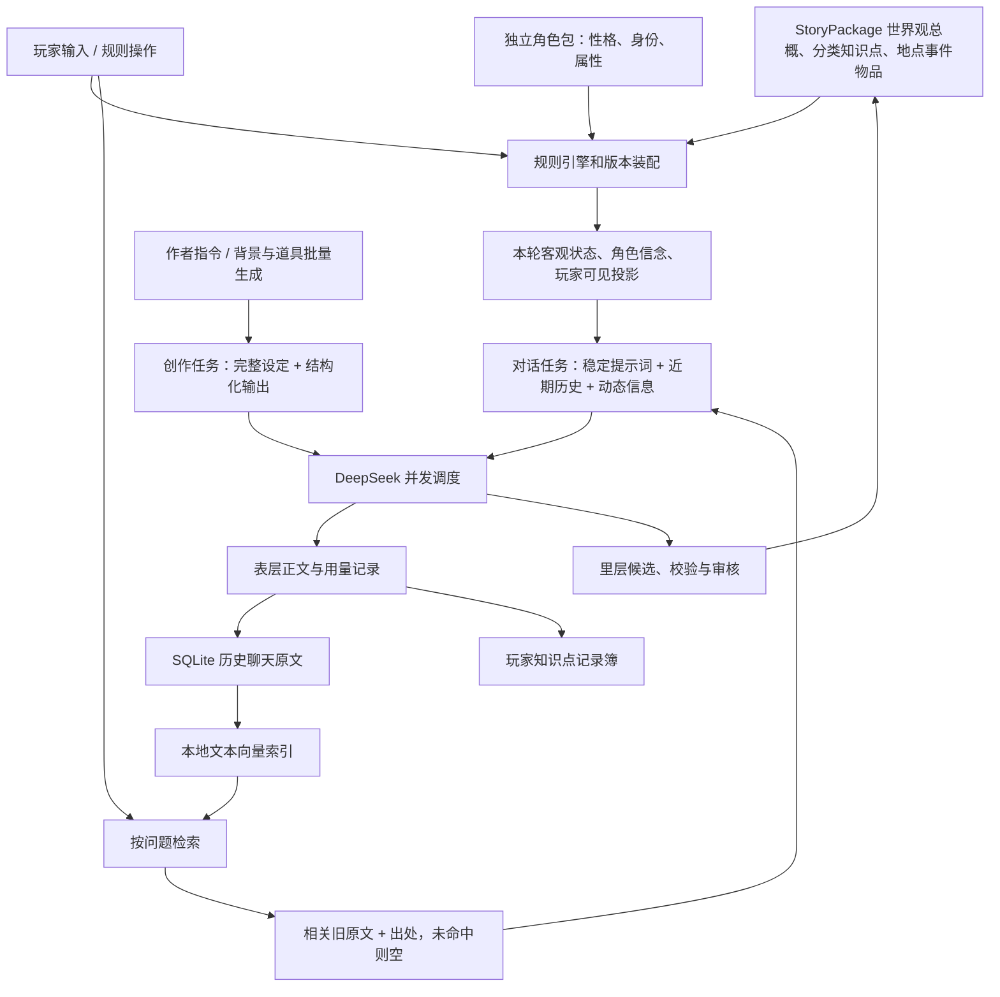

# 织梦 TextileDream · 当前框架与验证

## 本轮已落地

默认请求模型改为 `deepseek-flash`。2026-09-17 使用用户测试密钥查询 `/models`，得到 `deepseek-flash`、`deepseek-v4-pro`；官方价格页明确前者对应 DeepSeek-V4.1-Flash。真实响应也返回 `deepseek-flash`。

官方依据：
- https://api-docs.deepseek.com/quick_start/pricing
- https://api-docs.deepseek.com/guides/thinking_mode

API 页面支持默认模型、对话模型、创作模型、自定义模型 ID、推理开关、low/high/max 推理强度、温度、输出上限、超时与最大并发数。对话和创作模型留空时继承默认值；本机现已将三者设为 Flash，最大输出 8192，推理开启、高强度、并发 2。输出上限控件允许 200–65536，这是应用范围，不是宣称模型的全部容量。推理时不发送无效的温度参数；自定义供应商不强行发送 DeepSeek 专有参数。

密钥仍只在当前进程内存里，网页显示星号占位，留空保存不会清除。重启后需重新填写或设置环境变量。

## 当前数据和执行链

两种任务是两个独立的 API 请求上下文，不是两份互相自动共享记忆的模型。可以使用同一 Flash 服务，也可以分别选择模型。`Provider` 统一限制进行中的请求数。表层对话可与里层创作重叠；里层“生成背景 + 道具”通过并发请求生成两个独立候选。一项失败不会丢失另一项的成功候选。

世界状态由 Python 引擎处理，模型主要负责表达和候选生成。生成不会自动拿取物品、改变角色数值或批准新设定。候选仍绑定生成时的故事包版本，审核时阻止过期版本覆盖；现有旅程固定使用其故事包版本，新故事包内容不会偷偷改变旧旅程。

为了维持状态一致，旅程变更仍使用现有全局锁。当前不是多用户服务器；不同旅程的写操作也可能相互等待。今后可改为每旅程锁 + 故事包版本锁，不能简单移除锁。

## 聊天记忆机制

向量不等于关键词。本轮实现的是本地稀疏 TF-IDF 文本向量：中文相邻双字、英文词、少量明确的同义归一（如第一次/第1次、白粥/米粥），计算加权余弦相似度。无需额外依赖、嵌入 API 或远程 token；它也不是具备广泛语义理解能力的神经网络 embedding。

- 每轮原始输入和回复作为一个检索单元，保留事件、地点、原文和 `source_id`。
- 向量派生缓存存在 SQLite `recall_vectors`，原始存档才是权威来源。
- 按当前旅程隔离；查询时对照现存历史更新索引，删除回滚后失效的记录。
- 最近默认 6 轮直接进入上下文；旧原文仅在问题相关、超过阈值时召回，避免重复发送近期记录。
- 默认阈值 0.12，最多返回设置中的记忆条数。上下文超限先丢弃较弱匹配，不切坏 JSON。
- “第一次”优先有明确初次标记的相关原文，否则采用相关记录中最早出现者。不能保证“最早被记录”就是人生中第一次；跨省略历史和多种不同事件的时间推断仍需人工核实。
- 普通知识检索、近期状态和角色所闻仍存在，不是每轮彻底失忆再找关键词。
- 玩家旧对话不注入 NPC 专用上下文。检索出处包含场景参与者，但参与场景本身不证明听到了私语或内心活动。
- 里层新增“聊天记忆检索”可直接查看当前旅程命中的原文；“模型输入输出”控制台可查看实际发送的召回内容。

缺点：隐喻、泛指、无共同词的改写仍可能漏查；长篇原文的相似度也可能被无关词稀释。后续推荐保留词法检索，增加本地中文语义嵌入做混合召回，并用人物/时间/事件类型筛选。没有查到的记忆只能标为未知，不能自动判为从未发生。

## 已有功能状态

|模块|当前可用内容|边界|
|---|---|---|
|世界资料|世界观为故事包顶层，分类知识点文件按需读取，故事包阅读和版本化|不是完整历史模拟器|
|独立角色|角色包、性格权重、状态、信念；发展候选及审核|内心活动/言语/动作的证据分类还不完善|
|事件运行|事件链、条件、属性检定、行动效果、场景移动、归档回滚|自由文本不会自动实现任意动作|
|表里分层|玩家可见投影、完整作者候选、公开字段和解锁条件|表层一条请求扮演多人时，逐人知情仍主要靠提示约束|
|聊天|近期上下文、主要场景、默认连续分章、旧记录按需召回|上下文有限，不能宣称永久完美记忆|
|创作|人物、物品、地点、事件、事实、世界观、世界生成器、并发候选|候选需审核，跨候选引用没有自动依赖编排|
|记录与调试|玩家知识簿、源请求/响应、token 与缓存用量|知识簿摘要可能继承模型正文错误|
|界面|左侧导航、API/设置、地图、故事包阅读器、导出|地图仍是参考地图与测试位置|

## 真实验证及质量边界

第一轮：`artifacts/flash_workers_20260917_194114/`，6 次调用全部成功，输入 10285 token、输出 4926、缓存命中 3328（输入的约 32.4%）。

第二轮：`artifacts/flash_workers_20260917_195406/`，强化回忆提示后 6 次调用全部成功，输入 10635 token、输出 4290、缓存命中 4736（约 44.5%）。两轮合计 12 次，输入 20920、输出 9216。缓存差异同时受服务端热缓存、请求顺序和提示变化影响，不能据此证明本轮算法带来固定节省比例。

对照使用明确标注的合成聊天：先放入“第一次做炒肉和白粥”的评价，再放 30 轮干扰记录。开启召回找回正确旧原文；关闭召回没有找回；无关文书问题未召回做饭记录。真实模型回答开启时引用旧评价，关闭时表示记不起。

第一轮回忆擅自增加切法、火候，提示强化后第二轮未再增加这些细节。但普通正文仍写出未确认的行囊夹层、时间细节、屋舍归属等，说明“HTTP 成功 / JSON 合法 / 状态未污染”不等于“叙述可信”。测试没有批准候选或污染正式玩家存档。

另有 `tools/benchmark_v4.py --model deepseek-flash` 测资料长度、证据头中尾位置、推理开关、结构化规则遵循与角色发展。逐次原文、CSV、token 用量保存在对应 `artifacts/v4_benchmark_*` 目录。它衡量行为结果，不读取模型内部 attention，也不替代文学质量评价。

本次已完成 `artifacts/v4_benchmark_20260917_200505/`：30/30 通过，其中资料检索 18 例、状态与规则 8 例、角色发展 4 例；每个条件仅一次，不能据此推断普遍成功率或位置效应。输入 146379 token、输出 2880（其中返回的推理 token 共 2023），缓存命中输入 27648，约 18.9%。合并前两轮，本轮 42 次远程请求均成功，输入 167299、输出 12096、缓存命中输入 35712，约 21.3%。

最终本地回归 38/38 通过；Edge 浏览器验证配置保存及星号占位、背景与道具批量生成、原文检索、已有游玩和故事包操作通过，切换聊天 6 次未新增模型调用。

## 下一步建议（优先级）

1. 加强生成内容的事实校验：让正文的重要事实引用状态/记忆来源，对矛盾记录进行审阅；不能只查关键词，因为否定句、传闻和比喻很容易误判。
2. 明确输入通道：说出口、实际行动、内心活动、作者注分开。内心活动可以进入正文参考；普通感知只可根据可见迹象形成不确定推断，具体读心必须依赖世界规则与能力。当前角色发展模块仍可能把整段玩家输入当发言证据，需要继续修正。
3. 表层多角色的知情边界应由结构化角色观察和信念投影约束。仅把玩家历史交给一个叙事模型，无法严格保证每个 NPC 都不越权知情。
4. 给检索建立大一点的固定评测集：同义改写、第一次/第二次、人物混淆、跨场景、否定、未命中、隐私与回滚；再决定是否引入语义嵌入和重排模型。
5. 把角色发展候选“曾批准”和“回滚后仍有效”区分显示；目前回滚恢复状态，但旧候选审核状态不一定同步。
6. 后续并发扩展采用状态版本号和每旅程锁；需要前一步结果的任务保持串行。并发主要减少等待时间，不会让同样请求的 token 自动变少。

定位：当前是可本地试玩、可调试、有规则裁定与作者审核的叙事原型，尚不是叙述与知情边界完全可靠的成熟游戏引擎。
